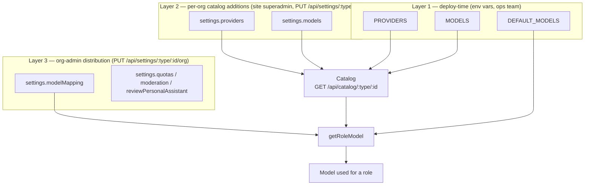

# Configuration: providers, models and credits

AI configuration is split across **three layers**, each owned by a different actor and stored in a different place. A request resolves a role (`assistant`, `tools`, `summarizer`, `moderator`) to a concrete model by walking the layers from the most specific (org mapping) down to the least specific (global default), then a per-role fallback chain.



## Layer 1 — global config (environment variables)

Set once per deployment, validated fail-fast at boot by `assertGlobalAiConfig` (`api/src/models/operations.ts`, called from `api/src/config.ts`). A bad value crashes the process immediately instead of failing on the first request. The `node-config` mapping lives in `api/config/custom-environment-variables.js`, defaults in `api/config/default.js`, and the full JSON Schema (used to `assertValid` the merged config at boot) in `api/config/type/schema.json`.

### `PROVIDERS`

JSON array of provider definitions. `type` is one of the 9 supported provider types: `openai`, `anthropic`, `google`, `mistral`, `openrouter`, `ollama`, `scaleway`, `openai-compatible`, `mock`. `id` must be unique. `ollama` and `openai-compatible` additionally require `baseURL` (enforced by `assertGlobalAiConfig`). API keys here are **plain text** (unlike per-org provider keys, which are encrypted at rest — see below) since they only ever live in the deployment's env/secret store.

```json
[
  {
    "type": "openai",
    "id": "global-openai",
    "name": "OpenAI (platform)",
    "enabled": true,
    "apiKey": "sk-..."
  },
  {
    "type": "scaleway",
    "id": "global-scaleway",
    "name": "Scaleway",
    "apiKey": "SCW...",
    "projectId": "11111111-1111-1111-1111-111111111111"
  }
]
```

### `MODELS`

JSON array of global model definitions, each referencing a `provider` id from `PROVIDERS`. `usage` flags which roles the model is *allowed* to serve (`assistant`, `tools`, `summarizer`, `moderator` — at least one, no duplicates). These four are the only roles: the former `evaluator` role was removed with the trace evaluator, and `upgrade/0.11.0/remove-evaluator-role.js` strips it from stored settings.

`inputPricePerMillion` and `outputPricePerMillion` are **mandatory**, in euros per million tokens, copied from the provider's own pricing page. `cachedInputPricePerMillion` is optional and means *unknown* when absent, not free — it falls back to the input price (see [Credits](#credits)). `assertGlobalAiConfig` rejects a model referencing an unknown provider id, rejects duplicate `provider/id` pairs, and **exits the process at boot** on a model missing either mandatory price, naming the offending `provider/id`. A price of `0` is legitimate; an absent one is not, because every account on this deployment can resolve a global model (see the [release note](#release-note-every-account-can-now-resolve-a-model-so-credits-are-the-gate) below) and a model free by omission would be an uncapped consumer of the deployment's own keys.

```json
[
  {
    "id": "gpt-5.4",
    "name": "GPT-5.4",
    "provider": "global-openai",
    "usage": ["assistant", "tools"],
    "inputPricePerMillion": 1.25,
    "cachedInputPricePerMillion": 0.125,
    "outputPricePerMillion": 10
  },
  {
    "id": "gpt-5.4-mini",
    "name": "GPT-5.4 Mini",
    "provider": "global-openai",
    "usage": ["summarizer", "moderator"],
    "inputPricePerMillion": 0.25,
    "outputPricePerMillion": 2
  }
]
```

### `DEFAULT_MODELS`

JSON object mapping each role to a `{ provider, id }` ref that must resolve to a model in `MODELS` **and** be flagged for that role's usage — both checked by `assertGlobalAiConfig`. This is the fallback used when an org has no `modelMapping` entry (or no org-owned config at all).

```json
{
  "assistant": { "provider": "global-openai", "id": "gpt-5.4" },
  "tools": { "provider": "global-openai", "id": "gpt-5.4" },
  "summarizer": { "provider": "global-openai", "id": "gpt-5.4-mini" },
  "moderator": { "provider": "global-openai", "id": "gpt-5.4-mini" }
}
```


### `EUROS_PER_CREDIT`

Plain number (not JSON), default `0.008`. Euros of inference cost per credit — the single peg that turns the per-model euro prices above into the billed unit.

`0.008` aligns credits with euros: resold at about one euro cent, a credit carries an implicit 20% margin. The credit is deliberately abstract — it is not meant to map to a number of tokens.

```
EUROS_PER_CREDIT=0.008
```

**This value must match the credit cost in `customers/docs/ai-credits-pricing.md`.** That document derives every plan allowance and every margin from it — the two have to be changed together, with nothing in either codebase checking it.

### `DEFAULT_CREDITS`

Plain number, default `0`. Fallback `ai_credits.limit` used by `getLimits()` (`api/src/limits/service.ts`) for any account that has no `limits` document yet, or whose document has no `ai_credits.limit` set.

`0` means **capped at zero**: the account is refused until something pushes it a real allowance — the `customers` service, or an ops admin via `POST /api/v1/limits/:type/:id`. That is the default because the alternative hands the deployment's own provider API keys to every account that has never been configured (see the release note below). Any negative value means unlimited; `-1` is the conventional spelling.

```
# a self-hosted instance that wants every account to just work:
DEFAULT_CREDITS=-1
# or a free-tier allowance for accounts customers has not priced yet:
DEFAULT_CREDITS=1000
```

A deployment left at `0` with no `SECRET_LIMITS` configured cannot receive allowances at all, so every account stays refused; the server logs a `[credits]` notice at boot for that combination.

### `SECRET_LIMITS`

Plain string, unset by default. Shared secret the external `customers` billing service presents as `?key=` on the `/api/v1/limits` endpoints (see [Limits contract](#limits-contract)). Compared in constant time by lib-express's `secretKeyMatches`, as data-fair's own limits router does. When unset, the `?key=` bypass is disabled entirely — it fails **closed** (an unset secret can never match, including against an unset query param), so no secret means the endpoints fall back to normal session auth rather than opening up.

```
SECRET_LIMITS=a-long-random-shared-secret
```

### Turn bounds: `TURN_CREDITS`, `LIVE_TURNS_PER_CALLER`, `TURN_TIMEOUT_SECONDS`, `TASK_TIMEOUT_SECONDS`, `COMPACTION_PERCENT`, `CODE_MODE_MAX_WORKERS`

JSON-parsed numbers, global rather than per account. They bound **every** turn of the server loop (`api/src/conversations/executor.ts`, the loop in `model-loop.ts`), the in-page chat's personal assistant as much as an autonomous agent.

| Variable | Default | Effect |
| --- | --- | --- |
| `TURN_CREDITS` | `500` | per-run credit ceiling; the turn stops with stop reason `budget` once crossed. A runaway ceiling, not a per-turn allowance — the account credit cap still applies on top. |
| `LIVE_TURNS_PER_CALLER` | `5` | chat turns one person, or one anonymous visitor's address, may have running at once; a further prompt is refused (429) until one ends. |
| `TURN_TIMEOUT_SECONDS` | `300` | wall-clock ceiling for one chat turn, so a hung model or MCP server cannot hold the conversation's lock. Independent of the NHI session lifetime: a longer turn renews its sessions. |
| `TASK_TIMEOUT_SECONDS` | `1800` | the same ceiling for a planned task's run, which nobody waits on (see [planned tasks](./planned-tasks.md#the-turn)). A deploy still stops a run after `SHUTDOWN_GRACE_SECONDS`. |
| `SHUTDOWN_GRACE_SECONDS` | `90` | on SIGTERM, how long running turns get to finish before being stopped as "the server restarted" (see [autonomous agents](./autonomous-agents.md#recovery)). The pod's `terminationGracePeriodSeconds` must exceed it by about 15 s. |
| `COMPACTION_PERCENT` | `70` | share of the assistant model's context window above which history is compacted (see [Context management](./context-management.md)). |
| `CODE_MODE_MAX_WORKERS` | `4` | `code_mode` scripts running at once in one process, one QuickJS worker (64 MiB heap) each; a script arriving when all are busy is refused, not queued (see [Code mode](./code-mode.md#engine-and-limits)). |

### `MCP_SERVERS`

JSON array of the MCP server catalog ops publishes for this deployment. Validated fail-fast at boot by `assertGlobalMcpConfig` (`api/src/mcp-servers/operations.ts`, called from `api/src/config.ts`), mirroring `assertGlobalAiConfig` above. Each entry has `id`, `name`, an optional `description`, `url`, `auth`, and an optional `profilesUrl`.

```json
[
  { "id": "docs-search", "name": "Docs search", "url": "https://mcp.internal/docs", "auth": "nhi-session" },
  { "id": "weather", "name": "Weather", "url": "https://mcp.example.com", "auth": "none" },
  { "id": "partner-crm", "name": "Partner CRM", "url": "https://crm.partner.example/mcp", "auth": "apiKey", "apiKeyHeader": "x-api-key", "apiKey": "..." }
]
```

`auth` selects how the MCP client authenticates to that server:

| `auth` | Behavior |
| --- | --- |
| `nhi-session` | Injects the calling autonomous agent's NHI session cookie (stack services). |
| `none` | Sends no credential (public or network-trusted endpoints). |
| `apiKey` | Sends a static, ops-owned header, from `apiKeyHeader`/`apiKey`. |

**`profilesUrl` makes an entry *profiled*.** It points at the server's profile vocabulary (data-fair's mcp
serves it at `/mcp-server/profiles`: names, titles, `includes`). A reference to a profiled entry selects
`profiles` instead of naming tools with `toolFilter`, and the selection reaches the server as the `profiles`
query parameter of `url` — the contract a server setting `profilesUrl` must follow. The entry's `url` must not
carry `profiles` itself. data-fair's mcp as one profiled entry:

```json
{ "id": "datafair", "name": "Data Fair", "url": "http://data-fair-mcp:8080/mcp-server/mcp", "profilesUrl": "http://data-fair-mcp:8080/mcp-server/profiles", "auth": "nhi-session" }
```

**`apiKey` is a deployment secret.** It lives only in this env var and is never returned by any API response, never written into an autonomous agent document, never included in a prompt, and never persisted in a stored conversation — `listMcpServerCatalog()` (`api/src/mcp-servers/operations.ts`) strips it before the catalog is exposed to org admins (`GET /api/autonomous-agents/:type/:id/mcp-servers`).

**This catalog IS the egress control for autonomous agents.** An org admin configuring an autonomous agent can only select MCP servers ops has already published here — there is no way to point an autonomous agent at an arbitrary URL from the org-admin side.

Boot validation (`assertGlobalMcpConfig`) rejects:
- a duplicate `id`;
- a `url` that is not `http:`/`https:`;
- an `auth: 'apiKey'` entry missing `apiKeyHeader` or `apiKey`;
- a credential (`apiKey`/`apiKeyHeader`) on an entry whose `auth` is not `'apiKey'` — a configuration mistake worth naming at boot, since the operator believes that endpoint is authenticated when it will never send the credential;
- a `profilesUrl` that is not an `http:`/`https:` URL, or a profiled entry whose `url` already carries a `profiles` parameter (it would be overwritten by each reference's selection).

### `PERSONAL_ASSISTANTS`

JSON object: the servers of the two built-in personal assistants, `portal` (`portal-assistant`, what a front-office embed talks to) and `backOffice` (`back-office-assistant`, what a back-office embed with `agents` talks to). Each is `{ "mcpServers": [{ "serverId": "…", "profiles": ["…"] }] }` (or `"toolFilter"` on a server without profiles), references into `MCP_SERVERS` exactly like a configured agent's. Example, data-fair's MCP with its read-only `catalog` profile for both:

```json
{ "portal": { "mcpServers": [{ "serverId": "datafair", "profiles": ["catalog"] }] }, "backOffice": { "mcpServers": [{ "serverId": "datafair", "profiles": ["catalog"] }] } }
```

Unset, an assistant has **no** catalog servers: the catalog is shared with configured agents, which need write profiles, so an assistant never takes it whole. An unknown `serverId` fails the boot (`assertPersonalAssistantsConfig`), and so does a reference breaking the profiled rules: no `profiles` (or a `toolFilter`) on a profiled server, `profiles` on one that declares none, the same profiled server twice. Profile names are not checked at boot, the server may be down then: a wrong one fails each turn by name. Whatever is configured, an assistant's calls that are not read-only wait for the person's approval (see [the approval gate](./autonomous-agents.md#the-approval-gate)).

### No signing key to configure

The ES256 keys that sign the assertions an autonomous agent exchanges for its own session (see [Autonomous agents](./autonomous-agents.md#identity-the-agent-acts-as-itself)) are the service's own state, managed as simple-directory manages its token keys (`api/src/tokens/keys-manager.ts` there): generated at the first boot, stored in mongo (`secrets`, `_id: 'nhi-signing-keys'`) with the private halves ciphered by `CIPHER_PASSWORD`, rotated every 30 days (`maintainNhiKeys`, `api/src/nhi/service.ts`). A new key is published in `/jwks` an hour before it signs, since simple-directory caches the JWKS, and the key it replaces stays published until the next rotation. Nothing outside this service holds a key: simple-directory reads the public halves through discovery, so a lost or suspect key is only a new one — delete that document and restart, and every enrolled agent keeps working.

### Verifying an autonomous agent's identity and tools

`GET /api/autonomous-agents/:type/:id/:agentId/tools` (`api/src/autonomous-agents/router.ts`) is the end-to-end proof that an autonomous agent's identity and MCP wiring actually work in a given deployment: it connects to every MCP server the agent references, as that agent's own identity, and returns the live tool list. It is a diagnostic, not the only path: the executor exists now (see [Autonomous agents](./autonomous-agents.md)) and reaches its tools the same way. This route plus the `/session` diagnostic below it are how an operator checks that wiring WITHOUT starting a turn. The procedure:

1. **Nothing to configure** on this service: the keys are its own (see above), and the issuer identifier is not configured, it is *captured* from the real proxied request that creates or saves the autonomous agent (`reqSiteUrl(req)`, see `api/src/nhi/operations.ts`), so it is always a url that demonstrably resolves here.
2. **Confirm discovery resolves** by requesting `<the site's own public url>/agents/api/nhi/.well-known/openid-configuration` through the reverse proxy (not directly on the API port — the issuer is meaningless without the proxy's `x-forwarded-*` headers).
3. **Create an autonomous agent** (`POST /api/autonomous-agents/organization/:id`) through the normal admin UI/API, referencing the MCP servers to verify.
4. **Register the NHI in simple-directory**, with `provider.issuer` set to the `nhi.issuer` now stored on the autonomous agent (`GET /api/autonomous-agents/organization/:id/:agentId`) and `subject` set to `autonomous-agent:<agentId>` (`autonomousAgentSubject()`).
5. **PUT the returned `nhi-…` id** onto the autonomous agent's `nhi.clientId`. The save performs a real exchange before accepting it (`assertEnrolmentWorks`), so a bad id, a wrong subject or an unreachable issuer is refused immediately at configuration time rather than surfacing later as a confusing failure inside a run.
6. **`GET …/:agentId/session`** to see which identity the exchange actually obtained (user id, org, session TTL) without ever returning the session cookie itself.
7. **`GET …/:agentId/tools`** to see the live tool list fetched as that identity — the deliverable this section documents.

**simple-directory must run with `manageNhis` enabled** (`MANAGE_NHIS=true`) for step 4 to work at all; it is what exposes `POST /api/organizations/:id/nhis`.

**`allowedIps` and `ipBinding` must not be set on an autonomous agent's NHI.** Both key off the address this service *declares* on the exchange (`DECLARED_CLIENT_IP`, a fixed `127.0.0.1` — see `api/src/nhi/operations.ts`) rather than any real client address, since the exchange is server-to-server and every autonomous agent on this deployment shares that one declared egress address. Binding either setting to a real pod/node IP breaks the exchange (a mismatched declared address) or the session it issues (a mismatched bound address on every subsequent call) — there is no real client IP here for either setting to usefully pin.

Registering the NHI is a one-time UI action, not a per-rotation chore: because discovery (`.well-known/openid-configuration` + `/jwks`) is fetched live rather than pinned, simple-directory picks up a new signing key automatically on rotation (it refetches the JWKS on an unknown `kid`) without the NHI record ever needing to be touched again. `/jwks` publishes the next key before it signs, so a rotation is never refused by a verifier holding an older copy.

### `AUTONOMOUS_AGENTS_REQUIRE_ADMIN_MODE`

Boolean, default `true`. `node-config`'s `__format: 'json'` parsing applies, so set it as `AUTONOMOUS_AGENTS_REQUIRE_ADMIN_MODE=false` to flip it, not `"false"` as a bare string.

While `true`, configuring an autonomous agent (`POST`/`PUT`/`DELETE /api/autonomous-agents/:type/:id[/...]`) additionally requires the caller to be a **site superadmin acting in admin mode** (`reqWriteSession` in `api/src/autonomous-agents/service.ts`, gated via `reqAdminMode`). Reads are unaffected — an org admin can always read their org's autonomous agents and MCP catalog, regardless of this flag.

This is a **progressive-rollout control, not an ownership boundary.** Nothing in the autonomous agent document is durably superadmin-owned: the flag only adds a session-level gate in front of the normal `assertAccountRole(session, owner, 'admin')` check every write route also performs. Setting it to `false` opens configuration to any admin of the owning organization, with no schema change and no migration — the same document shape, the same routes, just one fewer gate.

**Flipping it to `false` makes `assertAccountRole` the only thing separating an org admin from an org member on writes.** There is no second line of defense once the rollout gate is gone. Keep the org-member write-path tests in `tests/features/autonomous-agents/autonomous-agents.api.spec.ts` (the ones asserting a `requires admin` role-check message, not merely a 403) green — they are what proves `assertAccountRole` is actually still there and doing the job, rather than the rollout gate incidentally producing the same status code.

## Layer 2 — per-org catalog additions (superadmin)

`PUT /api/settings/:type/:id` (`api/src/settings/router.ts`), gated by `reqAdminMode` — a **site superadmin** acting in admin mode, not a regular org admin. This is where an org gets its own providers/models on top of the global catalog, e.g. a customer's own OpenAI key or an internal-only model.

- `settings.providers`: same shape as the global `PROVIDERS` array. `apiKey` is encrypted at rest (AES-256-CBC via `api/src/cipher/`) and obfuscated (`"********"`) in API responses; re-submitting the obfuscated placeholder preserves the stored encrypted value (`encryptProviderApiKeys` in `api/src/settings/operations.ts`).
- `settings.models`: array of `{ model: { id, name, provider: { type, name, id } }, usage: Role[], inputPricePerMillion, outputPricePerMillion, cachedInputPricePerMillion?, contextWindow? }` — the org-scoped equivalent of global `MODELS`, referencing `settings.providers` by embedded provider info rather than a bare id. Both mandatory prices are enforced by the PUT schema, so the route 400s on an entry without them — the write-time half of the boot check on global `MODELS`.

This route only ever touches `providers`/`models` (`+ updatedAt`) — it is a partial update, not a whole-document replace, so it never clobbers the org-admin-owned fields from Layer 3, including a Layer-3 write racing concurrently between its read and write.

## Layer 3 — org-admin distribution

`PUT /api/settings/:type/:id/org` (`api/src/settings/router.ts`), gated by `assertAccountRole(..., 'admin')` — any admin of that specific account, org or superadmin alike. The body is the **full** org-owned representation (whole-document semantics for this subset of fields): `modelMapping`, `quotas`, `moderation`, `reviewPersonalAssistant`.

- `modelMapping`: `Partial<Record<Role, { provider, id, name? }>>`. Each ref is validated against `GET /api/catalog/:type/:id` at write time — the route 400s if the ref isn't in the catalog, or is in the catalog but not flagged for that role's usage.
- `quotas`: per-role monthly caps plus the `untrusted` pool (see [Quotas & usage](./quotas-usage.md)); `quotas.global` no longer exists — the account-wide cap moved to the credits/limits system below.
- `moderation`: `{ enabled, categories }`, the opt-in input-moderation gate and which caller categories it checks (see [Moderation](./moderation.md)).
- `reviewPersonalAssistant`: whether the account offers [conversation review](./conversation-review.md) at all; each person must still consent per thread.

Both routes upsert (`$setOnInsert` seeds the other layer's defaults on a first write). An account with no settings document reads as `emptySettings` (`api/src/settings/service.ts`).

**Settings are cached in-process for 10s** (`getRawSettings`, `SETTINGS_TTL_MS`), because a single turn reads them several times and every read decrypts provider keys. Both PUT routes call `invalidateSettings(owner)`, so the writing instance sees its own write at once; the TTL only bounds how long another API instance takes to see it.

## Catalog

`GET /api/catalog/:type/:id?usage=<role>` (`api/src/catalog/router.ts`, admin-only) returns the merged view a given account can pick models from: `getModelCatalog()` (`api/src/models/operations.ts`) concatenates global `MODELS` with the org's `settings.models`, each tagged `source: 'global' | 'org'`. On both sides, a model whose provider is missing or `enabled: false` is skipped — so an org model orphaned by a provider deletion drops out of the catalog and any `modelMapping` still pointing at it is treated as an unresolvable ref (logged, fallen through) rather than being selected and then failing the request. The `usage` query param filters to models flagged for that role. This is what powers the `modelMapping` autocomplete in the org-admin form and the model-picker in the superadmin form (`api/types/settings/schema.js`).

### Role resolution (the catalog)

`getRoleModel()` (`api/src/models/operations.ts`) resolves a role for a request by walking a **fallback chain**, and at each step in the chain trying the org's `modelMapping` before the global `DEFAULT_MODELS`:

```
assistant:  assistant
tools:      tools      -> assistant
summarizer: summarizer -> assistant
moderator:  moderator  -> summarizer -> assistant
```

So for role `tools`: try `modelMapping.tools`, then `defaultModels.tools`; if neither resolves to a catalog entry, try `modelMapping.assistant`, then `defaultModels.assistant`. An unresolvable ref (e.g. a deleted provider) logs a warning and falls through rather than failing the request outright; only running out of the whole chain throws `No model configured for <role>`.

## Credits

Every LLM call — assistant turns, sub-agent delegations, the summarizer's compaction calls, moderator classification calls, and summary-endpoint calls — is priced in **credits**, not currency:

```
euros   = (noCacheTokens + cacheWriteTokens) × inputPricePerMillion       / 1_000_000
        +  cacheReadTokens                   × cachedInputPricePerMillion / 1_000_000
        +  outputTokens                      × outputPricePerMillion      / 1_000_000
credits = euros / EUROS_PER_CREDIT
```

(`priceTokensBreakdown()` and `toCredits()`, joined by `computeCreditBreakdown()`, in `api/src/usage/operations.ts`; every model call is charged through `chargeModelCall()` in `api/src/usage/charge.ts`.) The three prices come from the resolved catalog entry — global `MODELS[]` or org `settings.models[]` — and the peg is the global env var above.

**Cache reads are the reason this is priced per class.** Providers charge them at a fraction of fresh input (Scaleway: 0.08 €/M against 0.40, a factor of 5) and claim a 50–90% hit ratio on agentic workloads, so billing them at the fresh rate over-states input cost by 1.67x to 3.57x.

Three rules worth knowing:

- **An unset `cachedInputPricePerMillion` means unknown, not free.** It resolves to the entry's own value, then the snapshot the provider listing gave when the model was picked, then the input price — never to 0. OpenAI, Scaleway, LiteLLM and vLLM publish no cache tariff yet still cache implicitly, and 0 would bill those reads for free and silently loosen every credit cap.
- **Cache writes bill at the plain input price.** There is no write tariff to configure: this codebase never sets `cache_control`, so no provider reports write tokens today. They are billed rather than dropped so they cannot become free if one ever does.
- **`noCacheTokens` is taken verbatim** when the provider reports it (the AI SDK normalizes it as `usage.inputTokenDetails.noCacheTokens`); the subtraction `inputTokens - cacheRead - cacheWrite` is only a fallback, clamped at 0.

Credits, not euros, are what the account cap and every quota are denominated in, and what `limits.ai_credits` holds — the peg exists so a credit has a defined cost, not so the two become interchangeable in the API.

The `usage` MongoDB collection deliberately keeps its pre-existing field name `cost` (see `api/src/usage/service.ts`); the values it stores are credits, not money. This was a conscious choice to avoid a data migration of the `usage` collection itself — only the `settings` collection needed migrating (see [release note](#release-note-caps-shift-units-on-upgrade) below).

## Limits contract

The `limits` MongoDB collection and its `/api/v1/limits` endpoints (`api/src/limits/`) are the integration point with the external **customers** billing service, which owns the authoritative per-account credit allowance for accounts on a paid plan.

- `POST /api/v1/limits/:type/:id?key=SECRET_LIMITS` — customers pushes/updates an account's limits doc. Session admin-mode auth also works (no key needed) for manual/ops use. A push that omits `ai_credits` (or omits `ai_credits.consumption`) preserves whatever this service has already tracked locally — the route merges rather than overwrites that sub-object, so a customers-side push never zeroes out consumption this service already recorded.
- `GET /api/v1/limits/:type/:id?key=SECRET_LIMITS` — same shared-key auth, or session auth for any member of the account (`admin`/`contrib`/`user` role, any account the session belongs to). Lazily creates a `{ defaults: true }` doc on first read if none exists yet, seeded from `DEFAULT_CREDITS`.
- `GET /api/v1/limits?type=&id=` — bulk listing, key or admin-mode only.

Doc shape (`api/types/limits/schema.js`):

```json
{
  "type": "organization",
  "id": "acme",
  "name": "Acme Corp",
  "lastUpdate": "2026-08-14T12:00:00.000Z",
  "defaults": false,
  "consumptionMonth": "2026-08",
  "ai_credits": { "limit": 5000, "consumption": 123.45 }
}
```

`ai_credits.limit === -1` means unlimited. `defaults: true` marks a doc this service created and is fully responsible for (customers has never pushed to it); `defaults` is absent/false once customers has pushed a real limit.

**Enforcement.** `enforceQuotas()` (`api/src/usage/enforce.ts`) is the first turn gate of the server loop (`checkQuotas` in `api/src/conversations/turn-gates.ts`, before any model call) and also guards the summary endpoint. It checks, in order:

1. **Account credit cap** — `checkAccountCreditCap(owner)`: `getCreditInfo(owner)` against `ai_credits.limit`/`ai_credits.consumption`. `limit >= 0 && consumption >= limit` short-circuits, even if the caller's own per-profile quota is unlimited. A turn refused here is a stored refusal message (with a `data-refusal` part the chat localizes); the summary endpoint answers 429. The same check is re-run between steps of a long turn, since other runs can exhaust the shared cap meanwhile.
2. **Untrusted pool** — combined `anonymous` + `external` usage against `quotas.untrusted`, only for untrusted callers.
3. **Per-profile / per-user quota** — `quotas[role]` (`admin`/`contrib`/`user`/`external`/`anonymous`), only when usage is tracked per-user.

**While a turn runs**, every quota above is checked again after each step that called tools (`checkCeilings`, `api/src/conversations/model-loop.ts`), not only the account cap: other runs spend the same budgets meanwhile. And one caller — a person, or an anonymous visitor's address — may have at most `LIVE_TURNS_PER_CALLER` (default 5) chat turns running at once; a further prompt is refused with 429 until one ends. Together they bound how far turns started at the same moment on a nearly spent quota can overshoot it: about one step each. The public summary endpoint caps its output at 1024 tokens for the same reason.

The role is the stack's (`getEffectiveRole`, `api/src/auth.ts`, over lib-common-types' `getAccountRole`): the active account must match the owner, **department included**. Accounts here are organization roots, so a person whose active account is a department of the organization counts as `external` — a department role grants nothing implicitly on the root, an admin of a department included. Giving departments something (a quota of their own, a department wildcard) is a later extension of the quotas and of their settings UI, not an implicit rule.

See [Quotas & usage](./quotas-usage.md) for the full flow and the daily/weekly = monthly/2/4 derivation, unchanged by this refactor.

**Renewal semantics.** `incrementConsumption()` stamps `consumptionMonth` on every recorded credit spend. `resetDefaultsConsumption()` (`api/src/limits/service.ts`), run daily from the usage cleanup loop, zeroes `ai_credits.consumption` for any doc where `defaults: true` and `consumptionMonth` is behind the current calendar month — i.e. **only self-managed (`defaults: true`) docs reset automatically, on the calendar month.** A doc customers has pushed to (`defaults` absent/false) is never touched by this reset: customers is expected to reset `ai_credits.consumption` itself on the subscription's actual renewal day (which may not align with the calendar month), typically via the same `POST` endpoint.

### Customers-side integration checklist (separate work, not part of this refactor)

Wiring the `customers` service to actually push/read these limits is a separate session against the `customers` codebase, expected to need roughly:

- An `apis[]` entry pointing at `<agents-base-url>/api/v1/limits`, `types: ['ai_credits']`.
- `ai_credits` added to `renewableLimits`, `limitLabels`, and wherever `getLimitsType()` enumerates supported limit types.
- Plan features carrying `{ limit: { type: 'ai_credits', value: <number> } }` so a subscribed plan's credit allowance actually reaches the pushed limits doc.
- **A periodic consumption reset, mandatory.** The first `customers` push drops the `defaults: true` flag, and `resetDefaultsConsumption()` only ever renews docs that still carry it (see [Renewal semantics](#limits-contract) above). From that push onwards this service never zeroes `ai_credits.consumption` again, so the integration MUST post a reset on each subscription renewal — otherwise the account keeps accumulating consumption until it hits its limit and stays capped forever, with no server-side recovery path.

This list is a best-effort contract summary written from the `agents`-side implementation, not verified against the `customers` codebase — treat it as a starting point for that session, not a spec.

## Release note: caps shift units on upgrade

The `upgrade/0.10.0/better-config.js` migration (only runs once the deployed service version is bumped to **0.10.0 or higher** — see `api/src/server.ts`'s upgrade-script runner) turns every org's old `quotas.global.monthlyLimit` into the new `ai_credits.limit` on that org's `limits` doc (`unlimited`/falsy `monthlyLimit` → `-1`), and carries the role quotas over in `settings.quotas`.

**The budgets are preserved in currency terms.** The old caps (global and per role) were budgets in euros of inference; the new ones are in credits, worth `EUROS_PER_CREDIT` euros each. The migration divides every positive `monthlyLimit` by the peg, rounded to 2 decimals: an old 10 € cap becomes 1250 credits at the default `0.008`. It reads the peg from the `EUROS_PER_CREDIT` env var (default `0.008`, kept equal to `api/config/default.js` by a unit test), so it **must run with the value the deployment runs with**; an invalid value aborts the migration rather than storing wrong caps. The migration also carries each old role entry's `inputPricePerMillion` / `outputPricePerMillion` / `cachedInputPricePerMillion` onto its new catalog entry, so what a model costs does not change either. Usage recorded before the upgrade stays in euros in the `usage` collection, so role quotas under-count for the rest of the upgrade month.

**What does need review: migrated models that had no prices.** An old role entry without them migrates to `0`, which is what it cost before (the old resolver read every price `?? 0`), and that model bills **nothing** until an admin prices it. Boot validation cannot catch this — it guards new config, not stored documents.

**Operators must therefore review every migrated org's `settings.models[]` prices after upgrading**, alongside its `ai_credits.limit`.

## Release note: every account can now resolve a model, so credits are the gate

Before this refactor, an account with no `settings` document simply did not work: there was no global catalog, so nothing resolved a model for it. Configuration itself was the access gate. After it, two of the three relevant defaults point the other way:

- `getSettings()` returns `emptySettings` (rather than `null`) for an account with no document, and its `defaultQuotas.admin` is `unlimited`;
- the global `PROVIDERS`/`MODELS`/`DEFAULT_MODELS` resolve a model for any account, with no per-account configuration.

So on a deployment with global providers configured, **every account — including every user's personal account, and every account no superadmin has ever touched — can resolve a model and would consume the deployment's own provider API keys.** The credit cap is now the only thing standing in front of that, which is why `DEFAULT_CREDITS` defaults to `0`: an account with no `limits` document is refused until the `customers` service (or an ops admin, via `POST /api/v1/limits/:type/:id` in admin mode) pushes it a real allowance.

Two consequences to plan for **before** upgrading:

- **A deployment that relies on the `customers` integration needs `SECRET_LIMITS` set**, or nothing can push allowances and every account is refused. The server logs a `[credits]` notice at boot for exactly that combination.
- **A self-hosted instance that wants accounts to just work must set `DEFAULT_CREDITS=-1`** (or a finite free-tier number). That restores the "works out of the box" posture, at the cost of every account being an uncapped consumer of the deployment's keys — the server logs a `[credits]` notice for that too.

Existing orgs are unaffected by this default: the migration seeds each one an `ai_credits.limit` from its old `quotas.global` (see the previous section), so only accounts that never had a global quota fall through to `DEFAULT_CREDITS`.

## Files

The file store of autonomous agents ([Agent files](./agent-files.md)). Unset: files are off and nothing
file-related is offered. Validated at boot (`assertFilesConfig`), and the store's access is checked at boot.

| Env var | Config | |
|---|---|---|
| `FILES_STORAGE` | `files.storage` | `fs` or `s3` |
| `FILES_DATA_DIR` | `files.dataDir` | `fs`: a directory on a volume shared by every node when scaled |
| `FILES_S3_ENDPOINT`, `FILES_S3_REGION`, `FILES_S3_BUCKET`, `FILES_S3_ACCESS_KEY_ID`, `FILES_S3_SECRET_ACCESS_KEY`, `FILES_S3_FORCE_PATH_STYLE` | `files.s3.*` | `s3` (`bucket` required; path-style by default) |
| `FILES_SECRET` | `files.secret` | at least 32 characters; signs the file URLs MCP servers fetch |
| `FILES_PUBLIC_URL` | `files.publicUrl` | the agents API base URL as the MCP servers reach it; they set it as `FILE_URL_PREFIXES` |

Dev: `fs` on the gitignored `dev/data/files`, `publicUrl` the API's own dev port.
