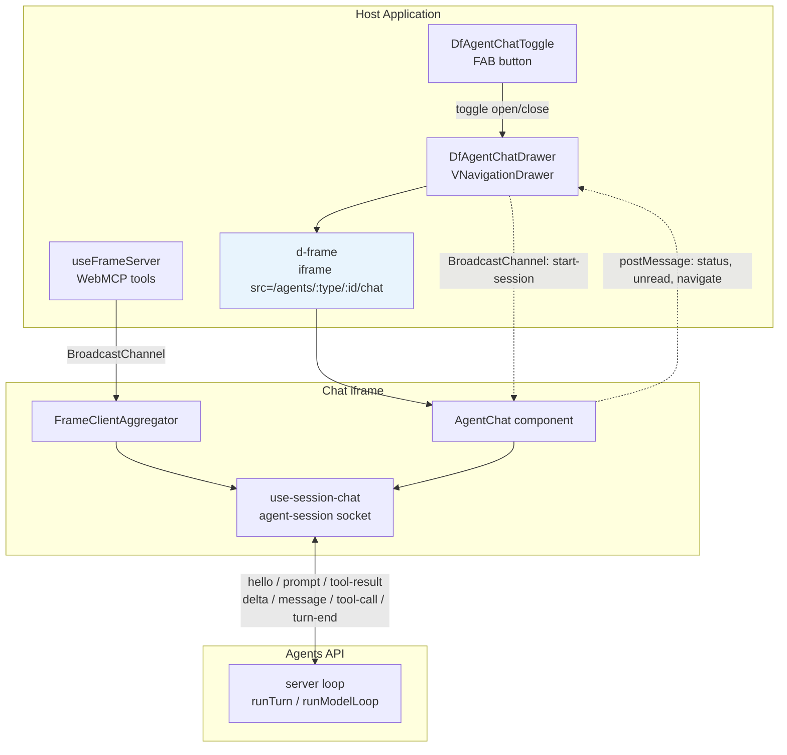

# Embedding

The chat UI is designed to be **embedded as an iframe** in any data-fair application. `lib-vuetify` provides ready-made container components: a floating `DfAgentChatDrawer`, a popover `DfAgentChatMenu`, and a flat in-page `DfAgentChatBlock` (always visible, for embedding a custom chat directly in a portal page).

The iframe is only the chat's UI. The agent loop runs on the server (`api/src/conversations/executor.ts`); the iframe talks to it over a websocket **agent session** (`ui/src/composables/use-session-chat.ts` / `use-agent-session.ts`, protocol in `shared/agent-session-protocol.ts`). The host page's tools never leave the browser: the iframe discovers them, declares them to the server, and runs them when the server asks.



**Communication channels:**
- **BroadcastChannel** — Tool discovery (MCP), host events, session lifecycle (`agent-start-session`, `agent-chat-ready`, ping/pong)
- **postMessage (d-frame)** — Status updates (`agent-status`), unread indicators, tools-changed notifications, link navigation
- **sessionStorage init-config** — One-shot host→iframe handoff of `title` and `agentId` (keyed by a `?initConfig=<key>` URL param). See [Initial Configuration](#initial-configuration-agentid--title).
- **Agent-session websocket** — iframe ↔ server: the conversation itself, and the server's calls back into the page's tools.

**Singleton composables** (`useAgentChatDrawer`, `useAgentChatMenu`, `useAgentChatBlock`) ensure a single instance across the host app. Only the drawer's open state persists to `localStorage`; the menu always starts closed (it persists only its expanded size), and the block is always open.

---

## Component Options

### Drawer — `DfAgentChatDrawer`

A floating side drawer (Vuetify `VNavigationDrawer`) that embeds the chat iframe:

```vue
<template>
  <DfAgentChatDrawer
    account-type="organization"
    account-id="my-org"
    chat-title="Data Assistant"
    agent-id="personal"
  />
  <DfAgentChatToggle />
</template>
```

The drawer appears on the right side of the viewport at z-index 2500 (above `v-dialog`). Use `DfAgentChatToggle` to add a FAB button that opens/closes it.

### Menu — `DfAgentChatMenu`

An alternative that renders the chat as a popover menu (400x500px default):

```vue
<template>
  <DfAgentChatMenu
    account-type="organization"
    account-id="my-org"
    chat-title="Data Assistant"
    :menu-props="{ width: 500, height: 600 }"
  />
</template>
```

The menu includes a built-in activator button (FAB with status indicator) and a close button. It auto-focuses the iframe on open.

### Block — `DfAgentChatBlock`

Renders the chat iframe **flat inside the page** (no drawer, no popover, no FAB) — it fills its container and is always visible. This is the variant to use for embedding a custom chat directly in a portal page rather than as a floating overlay:

```vue
<template>
  <v-card style="height: 600px;">
    <DfAgentChatBlock
      account-type="organization"
      account-id="my-org"
      chat-title="Data Assistant"
      agent-id="personal"
    />
  </v-card>
</template>
```

Because a block is always open there is no open/close state, no `localStorage` persistence, and no toggle/unread badge — give the parent element an explicit height since the iframe stretches to fill it.

### Props

All three components (drawer, menu, block) accept:

| Prop | Type | Description |
|------|------|-------------|
| `accountType` | `string` | `'user'` or `'organization'` |
| `accountId` | `string` | Account ID for the chat session |
| `src` | `string` | Custom iframe URL (overrides account-based URL resolution) |
| `chatTitle` | `string` | Title displayed in the chat header |
| `agentId` | `string` | Which agent to talk to (`api/src/agent-session/standard-agents.ts` for the standard ones; `personal` is the default). Replaces `systemPrompt` |
| `agents` | `boolean` | **Back-office mode**: the chat offers the agent switcher (the personal assistant plus every autonomous agent the caller may instruct in the account). Off — the front-office shape — embeds stay mono-agent. The conversation history is offered to every signed-in person either way |
| `systemPrompt` | `string` | **Deprecated, ignored** — logs a one-time console warning (`hostInitConfig`) |
| `initConfigKey` | `string` | Override the per-variant init-config key. Only needed when mounting several instances of the same variant in one tab (defaults to `'drawer'` / `'menu'` / `'block'`) |

Drawer-specific: `drawerProps` (pass-through to `VNavigationDrawer`).
Menu-specific: `title`, `btnProps`, `menuProps`, `cardProps` (pass-through to Vuetify components).

---

## Singleton State

Drawer, menu and block each use a **singleton composable** — calling one from multiple components returns the same shared state:

```typescript
import { useAgentChatDrawer } from '@data-fair/lib-vuetify-agents'

const state = useAgentChatDrawer()
// state.drawerOpen, state.agentStatus, state.hasUnread, state.fabIcon, state.fabColor
```

The drawer's open state is persisted to `localStorage` (`df-agent-chat-open`), so it stays open across page navigations. The menu's open state is deliberately not persisted — restoring it made the menu pop up on its own — only its expanded size (`df-agent-menu-expanded`). The block has no open/close state (it is always visible) and so persists nothing.

---

## Status Indicator

The FAB button reflects the chat agent's current state:

| Status | Icon | Color |
|--------|------|-------|
| `idle` | robot | secondary |
| `working` | robot (loading spinner) | accent |
| `waiting-user` | question mark | warning (an answer is waiting, or the agent declared `wait_for_user_action`) |
| `error` | alert circle | error |

When tools change dynamically, the button flashes `accent` for 3 seconds (`toolsJustChanged`).

An unread badge (red dot) appears when the agent produces a response while the drawer is closed.

---

## iframe Communication

The chat iframe and host app communicate through two channels:

### postMessage (via d-frame)

The iframe sends `AgentChatMessage` events to the host via the `d-frame` custom element's `@message` event:

| Message | Purpose |
|---------|---------|
| `{ type: 'agent-status', status }` | Updates FAB icon/color |
| `{ type: 'tools-changed' }` | Triggers accent flash |
| `{ type: 'unread', unread: boolean }` | Shows/hides unread badge |
| `{ type: 'navigate', url }` | A link clicked in the chat: the host navigates in-SPA when the URL maps to one of its routes, otherwise does a full navigation (another origin opens in a new tab) |

### BroadcastChannel (tab-wide)

Used for session lifecycle — any frame on the same origin can interact:

| Message | Direction | Purpose |
|---------|-----------|---------|
| `agent-chat-ready` | Container → all | Announces drawer/menu/block presence |
| `agent-start-session` | Action → container + iframe | Opens the container; the iframe starts a chat with `visiblePrompt` + `hiddenContext` |
| `agent-session-cleared` | Action → iframe | Signals that an action button was unmounted |
| `agent-chat-ping` | Action → container | Discovery probe |
| `agent-chat-pong` | Container → action | Presence response |

Host events (`agent-event`, `agent-state-withdrawn`, `agent-state-request`) travel on the same tab channel; see [Host events](./host-events.md).

---

## Exposing Tools from the Host App

The host application can expose tools to the chat agent via MCP over BroadcastChannel:

```vue
<script setup>
import { useFrameServer, useAgentTool } from '@data-fair/lib-vue-agents'

// Step 1: Start an MCP server on BroadcastChannel
useFrameServer('parent')

// Step 2: Register tools — they are automatically exposed to the chat iframe
useAgentTool({
  name: 'query_data',
  description: 'Run a SQL query on the current dataset',
  inputSchema: {
    type: 'object',
    properties: { sql: { type: 'string' } },
    required: ['sql']
  },
  execute: async ({ sql }) => {
    const result = await myApi.query(sql)
    return JSON.stringify(result)
  }
})
</script>
```

`useFrameServer('parent')` must be called **before** registering tools (or at least in the same setup scope). It replaces `navigator.modelContext` so that all registered tools are exposed via BroadcastChannel.

Tools are automatically unregistered when the component unmounts (via `onScopeDispose`).

The chat iframe's `FrameClientAggregator` discovers the server, and the iframe declares its tools to the agent session (`hello`, then `tools-changed` whenever the set changes). The model runs on the server, so a call comes back down the socket as a `tool-call` frame; the iframe executes the tool through the aggregator and answers with a `tool-result` carrying either `result` or `error`. The implementation never leaves the page. See [MCP tool integration](./mcp-tools.md) for the full protocol.

---

## Declaring Sub-Agents

Host applications can also declare sub-agents that have exclusive access to specific tools:

```vue
<script setup>
import { useFrameServer, useAgentTool, useAgentSubAgent } from '@data-fair/lib-vue-agents'

useFrameServer('parent')

// Register tools
useAgentTool({ name: 'query_data', ... })
useAgentTool({ name: 'get_schema', ... })

// Declare a sub-agent that owns those tools
useAgentSubAgent({
  name: 'analyst',
  title: 'Data Analyst',
  description: 'Analyzes datasets using SQL queries',
  prompt: 'You are a data analyst. Use query_data and get_schema to answer questions.',
  tools: ['query_data', 'get_schema'],
  model: 'tools'
})
</script>
```

The main agent will delegate to `subagent_analyst` rather than calling `query_data` directly. The `subagent_*` tool only returns its configuration: the server loop calls it over the socket, then runs the worker itself (`api/src/agent-session/sub-agents.ts`), the worker's page-tool calls coming back to the page like any other. See [Sub-agent orchestration](./sub-agents.md) for details.

---

## Reporting State and User Actions

Pages can tell the chat what is true now and what the user did, so the assistant does
not have to ask (`get_current_location`-style) and can hand a step back to the user and
resume when they act. Full mechanism in [Host events](./host-events.md).

```typescript
import { useAgentState, emitAgentEvent } from '@data-fair/lib-vue-agents'

// Keyed state: the last value per key is retained; changes are coalesced.
useAgentState('location', () => ({ path: route.path, name: route.name }))
useAgentState('wizard', () => ({ step: step.value, type: type.value, title: title.value }))

// Transitions: emitted once, delivered once.
router.afterEach((to, from) => emitAgentEvent('navigated', { from: from.path, to: to.path }, { key: 'location' }))
emitAgentEvent('dataset-created', { id: dataset.id, title: dataset.title })
```

Emit an event when the assistant should be told even if it was not looking; give it a
key when a later occurrence supersedes it. Nothing here starts a model turn.

---

## Starting Sessions Programmatically

Action buttons or host-app logic can trigger a chat session via BroadcastChannel:

```typescript
import { getTabChannelId } from '@data-fair/lib-vue-agents'

const channelId = getTabChannelId()
const bc = new BroadcastChannel(channelId)

bc.postMessage({
  channel: channelId,
  type: 'agent-start-session',
  visiblePrompt: 'Help me explore this dataset',
  hiddenContext: 'Dataset: sales_2024, columns: date, product, revenue, region'
})
```

The container composable listens for `agent-start-session` and automatically opens. The `visiblePrompt` is shown to the user; `hiddenContext` is passed to the agent without displaying it: the iframe sends it as its own field of the `prompt` frame and the server does the `<hidden-context>` wrapping, so a client cannot place the sentinels itself.

To check if a drawer is available before sending:

```typescript
bc.postMessage({ channel: channelId, type: 'agent-chat-ping' })
// Listen for 'agent-chat-pong' response
```

### Inline action button

`DfAgentChatAction` is a button a host app drops directly into a page (for example a contextual "ask the assistant" help action next to a creation or configuration form — this is how it is used in data-fair on creation/config pages). On mount it pings over BroadcastChannel for a live drawer and only shows itself once one answers (`agent-chat-pong` / `agent-chat-ready`). On click it broadcasts an `agent-start-session` message carrying a `visiblePrompt` (shown to the user) and a `hiddenContext` (page context passed to the agent silently), which opens the drawer and starts the conversation. It also stores the message in sessionStorage (`df-agent-pending-action`), which the iframe reads on mount, for when the iframe was not loaded yet to hear the broadcast. It is the declarative, in-page counterpart to the programmatic `agent-start-session` snippet above.

---

## URL Resolution

The iframe URL is resolved as follows:
1. If `src` prop is provided → use it directly
2. Otherwise → `{origin}/agents/{accountType}/{accountId}/chat`

The drawer/menu/block components then append `?initConfig=<key>` (see next section) and, when the `agents` prop is set, `&agents=1`.

> **Direct-URL embeds:** the chat page reads `?title=`, `?agentId=` and `?agents=1` query params directly. The former `?systemPrompt=` is gone: it let anyone who could craft a link set the model's instructions. An unknown agent id is refused by the server.

### Back-office mode (`agents`)

The same chat window serves both offices. In the front office (portals) it is embedded with no `agents` prop: one agent. In the back office (data-fair) the host sets `agents`, and the header gains an **agent picker** fed by `GET /api/conversations/:type/:id/agents` — the standard agents the caller may use plus every enabled configured agent they may instruct (`canInstruct`), so the list cannot offer one the first message would be refused for — and a **New conversation** button in place of Reset.

Both offices, for any signed-in person:

- the **history** menu is fed by `GET /api/conversations/:type/:id` without an `agentId` — the caller's own non-empty threads across the agents they may still use, newest first (at most 50), each labelled with its agent. Selecting one rebinds the socket to it and the server replays its stored transcript. It is always the caller's own threads, a superadmin's included: reading other people's is the review page's job.
- opening the chat **resumes** the agent's thread with the latest activity (`?agentId=…&size=1`) rather than starting another.

Selecting a different agent resumes ITS latest thread; a conversation never changes agent, since its identity is the agent that answered in it. The back office creates conversations lazily, on the first message, so switching to an agent with no thread leaves nothing behind; the front office creates its thread on open, and resuming it is what keeps reloads from piling up empty ones.

---

## Initial Configuration (agentId & title)

The `agentId` and `chatTitle` props are handed to the iframe through **same-origin sessionStorage**, not the URL. This is a one-shot "set then get" handoff: the host writes the config before the iframe loads, and the iframe reads it once on mount. It is **not** a reactive channel — changing the prop after the iframe is running does not update the live agent.

The mechanism was introduced to carry an arbitrarily long `systemPrompt` past nginx's request-line limit and out of logs and `Referer` headers. A host no longer supplies prose: with the loop on the server, a host-supplied prompt would be the one remaining client-controlled instruction, so a host names a standard agent instead and the persona lives server-side (`api/src/agent-session/standard-agents.ts`). The deprecated `prompt` field is ignored.

How it works:
1. Each component writes `{ agentId, title }` to sessionStorage under a per-variant key via `setAgentInitConfig(key, hostInitConfig(props))` (`hostInitConfig` drops `systemPrompt` with a one-time warning).
2. The component appends `?initConfig=<key>` to the iframe URL.
3. The chat iframe (`AgentChat.vue`) reads its key from the URL and loads the config via `getAgentInitConfig(key)`. It takes both fields: the title (init config wins over props) and the agent id (the page's `?agentId=` wins, then the init config), which is what makes an embedded chat actually talk to the agent its host named.

The key defaults to the variant name (`'drawer'` / `'menu'` / `'block'`), so one of each can coexist in a tab without clobbering. Mounting several of the **same** variant in one tab requires distinct `initConfigKey` props.

You can also use the helpers directly when building a custom embed:

```typescript
import { setAgentInitConfig } from '@data-fair/lib-vue-agents'

setAgentInitConfig('my-chat', { agentId: 'personal', title: 'Portal Help' })
// then load the iframe with `…/chat?initConfig=my-chat`
```

---

