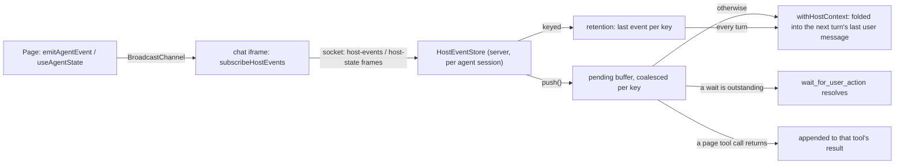

# Host events

The chat only learns what it asks for, and only when a message arrives — unless the host
tells it. This document covers how a host page reports what happened and what is true
now, how that reaches the server-held loop and the model without ever starting a turn,
and the one tool that lets the agent hand the next step to the user and get it back.

## The model

The host reports **events**, one primitive. An event is *keyed* when it describes
something with a current value (the location, a wizard's state): the store retains only
the last event per key and coalesces pending ones per key. An unkeyed event is a
transition (creation done, dialog dismissed). Navigation is emitted once, keyed
`location`: retention holds where the user is, the delivery is the transition.

Rule of thumb for a page author: **emit an event when the assistant should be told even
if it was not looking, or even if the state afterwards looks the same; give it a key when
a later occurrence supersedes it.** Typing a title is state (keyed `wizard`); pressing
Create is a transition (`item-created`); leaving the page is both (`navigated`, keyed
`location`).

The loop runs on the server (`api/src/conversations/executor.ts`), so the store does too.
The page publishes on the tab BroadcastChannel; the chat iframe forwards each event, raw,
up its agent-session socket; the server feeds the socket's `HostEventStore`. Retained
state is told to the model on **every** turn; events are told **once**, drained from the
pending buffer by whichever delivery reaches them first. Nothing is re-sent, and the host
never starts a turn.

## Publishing (`@data-fair/lib-vue-agents`)

- `emitAgentEvent(name, detail?, { key? })` posts `{ type: 'agent-event', event }` on the
  tab BroadcastChannel (`getTabChannelId()`). `detail` is serialised (JSON for objects)
  and capped at 1000 chars (`EVENT_DETAIL_MAX_CHARS`), suffixed `… [truncated]` when it
  overflows. A raw string `detail` also has its real newlines escaped (mirroring what
  `JSON.stringify` already does for the object branch) and the wrapper sentinels
  (`</hidden-context>`, `</host-events>`, `</host-state>`) neutralised, before the cap —
  otherwise a host mirroring free user text (a wizard title, a description field) could
  break the line-oriented `<host-events>`/`<host-state>` block format or forge an early
  close of the `<hidden-context>` wrapper.
- `useAgentState(key, source)` watches a ref/getter (`immediate: true, deep: true`) and
  emits a keyed event when the serialised value changes; on scope dispose it posts
  `agent-state-withdrawn`, which only removes the key from retention (the model is not
  told — if leaving mattered, emit `navigated`). It answers the chat's
  `agent-state-request` by re-emitting the last value, so a chat that loads after the page
  rebuilds retention.
- The three message shapes (`agent-event`, `agent-state-withdrawn`,
  `agent-state-request`) share one `channel` field but otherwise diverge, so the publisher
  side types the post function as `HostEventPost = (msg: DistributiveOmit<HostEventMessage,
  'channel'>) => void` — a hand-rolled distributive omit (`T extends any ? Omit<T, K> :
  never`), because a plain `Omit` over a union collapses it to the common `type` field
  first and loses `event`/`key` in the process. `createStateEmitter` takes this `post` as
  a parameter so the emit-on-change logic is unit-testable without a real
  `BroadcastChannel`.

## Forwarding (`ui/src/composables/use-host-events.ts`, `use-session-chat.ts`)

`subscribeHostEvents` listens on the tab channel and, on creation, posts one
`agent-state-request` so pages that mounted earlier re-emit their keyed state. The
channel is still an untrusted boundary, so it shape-guards each raw `agent-event`
(`sanitizeEvent`: a string `name`, a finite `at` falling back to `Date.now()`, a
non-string `key` dropped rather than coerced). `use-session-chat.ts` forwards every event
verbatim as a `host-events` frame and a withdrawal as a `host-state` frame with that key
set to `null`. Raw events rather than a digest, because the server holds the same
`HostEventStore` class: forwarding reproduces its retention and coalescing instead of
reimplementing them.

The chat also reports facts of its own as host state (`AgentChat.vue`'s `hostContext`:
the person's language, organization, whether the surface is narrow, whether diagrams
render). These used to be concatenated into a client-built system prompt; the prompt is
the server's now, and as state the next turn simply sees a changed value.

## Consuming (`shared/host-events.ts`, `api/src/agent-session/session.ts`)

Each agent session (one socket) owns one `HostEventStore`. `host-events` frames are
`push()`ed as they come; a `host-state` frame pushes each key as a keyed event, and a
`null`/absent value withdraws the key. A re-hello naming a different conversation is a
reset: `clearPending()` drops the buffer while retention stays — it is still true of the page.
Each frame is also reported to the session service (`onHostEvents`), which is how a pending wait
learns the person acted (see the wait section).

The store holds retention (a `Map` of last event per key, iteration order doubling as
first-seen key order, capped at `STATE_MAX_KEYS` distinct keys — oldest dropped first;
plus a ring of the last `RECENT_MAX` unkeyed events, which nothing reports any more), the
pending buffer (undelivered, coalesced per key; unkeyed events additionally ringed at
`PENDING_MAX` — keyed ones already self-limit to one slot per key). There is no waiter:
a pending wait is answered FROM the buffer (`hasWaitAnswer`/`takeWaitAnswer`), by the first
event that resolves a wait (see below) followed by everything else pending.

Delivery, in `api/src/conversations/executor.ts` and `api/src/agent-session/browser-tools.ts`:

1. **Pending wait** — the event settles the open `wait_for_user_action` call, and a `wake`
   turn continues from it.
2. **Caused by a page tool call** — when the page answers a `tool-call`, pending events
   are drained and appended to that tool's result as a `<host-events>` block
   (`appendHostEvents`): the event lands in history exactly where it happened (the
   Playwright "action returns the resulting page" shape), so the model decides its next
   step on the page its own call produced. A sub-agent worker's page tools are the same
   tool objects, so they drain the same shared buffer.
3. **Otherwise** — at the start of the next turn, `withHostContext` folds a block set into
   the `<hidden-context>` wrapper of the **last user message**: a `<host-state>` block of
   the retained keys (without the recent-actions ring), then the drained `<host-events>`,
   then any trailing reminder (see the wait section). Into the user turn rather than the
   system prompt, because the system prompt is the stable cacheable prefix and state
   presented there reads as a standing rule. It decorates that request only and is not
   persisted. Both content shapes are handled — `convertToModelMessages` gives every user
   message an array of parts, which a string-only first version silently skipped.

State is sent every turn rather than only on "activation" (first turn, after reset, after
compaction), which is what the browser loop did. That removed a whole concept — and the
activation-only filter that dropped keyed events already shown in the state block. The
cost: a keyed change is pushed into both retention and the pending buffer, so the turn
after it reports the same value twice, once in `<host-state>` and once in `<host-events>`.

Both blocks say they are reported by the application, not written by the user. The
[moderation](./moderation.md) gate classifies the stored last user message — an action
button's hidden context included, since the server wraps a `prompt` frame's
`hiddenContext` and stores it — but the host blocks are added after the gates and never
stored, so moderation does not see them, and a refused turn leaves the events pending.

## `useAgentLocation`

Nothing here tracks navigation on its own: a host publishes what it knows, and
retention puts it in the state block. Every host with a router wants the
same thing, so `useAgentLocation(() => ({ path, name?, params?, query?,
breadcrumbs? }))` is that code once, publishing under the canonical `location`
key.

Its job beyond `useAgentState` is the absolute `url`, derived from `path` against
the current origin unless the host supplies its own (a path prefix, a different
public origin). A judged run had the assistant hand the person a relative path
that the chat rendered as inert plain text — not even a broken link — while the
absolute URL sat unused in the host-state block of the very same request.
`buildAgentLocation` is exported separately so a host can unit-test what it
publishes without a browser.

## `wait_for_user_action`

A loop-provided tool (`WAIT_TOOL_NAME`, built by `createWaitTool` in `shared/host-events.ts`),
added to a turn's tool set whenever an agent session is attached — someone is there to act. It
is a fixed tool of the lead's set; sub-agent workers only receive the tools they reserve.
`{ message, expecting }`. `message` is the model's reply to the person — what is ready and what
to press — and `expecting` is only the status label. Before `message` existed, models read the
« En attente : … » label as their message and handed buttons over in silence. The loop adds the
message to the step's own text when it records the call (`waitHandover`), just before the call
and unless that text already says it — judged on the words, since models reword: most of the
message's significant words already in the step's text (`HANDOVER_ALREADY_SAID`) — and streams it — so it is part of the stored conversation,
and a reloaded or reviewed thread shows the same handover. Before the call, not after: text after
a tool call is replayed to the model as a separate assistant message it never wrote. A wait with
no message is refused so the model retries with one, and a known small-model slip (the other
arguments serialised into the message string) is repaired (`repairWaitInput`).

**The wait is a handover, not a pause: calling it ENDS the turn.** The tool returns an accepted
marker (`WAIT_ACCEPTED`) that the model never reads: a stop condition ends the loop on it, the
call is stored OPEN (`input-available`), the run closes `done` with stop reason `waiting`, and the
same write records the conversation's `pendingWait` (`messageSeq`, `toolCallId`, `expecting`, who
handed over, and where the page was). Nothing is held in between — no run, no lock, no MCP
connection, no clock. Whatever the person does next settles it (`api/src/conversations/waits.ts`),
and since a click, a message and Stop can race, settling starts by claiming `pendingWait` with an
atomic `$unset`: exactly one of them wins.

- **They act on the page.** The session reports every host frame (`onHostEvents`), and
  `wakeIfAnswered` (in the executor) checks the buffer: if it holds an answer, the call is settled
  with a `<host-events>` block of it — the first thing the person did, then the followers of the
  same gesture and the refreshes that arrived meanwhile, exactly what the blocking tool used to
  return — and a run with trigger `wake` starts. It carries no message of the person's: its history
  ends on that settled result, so the model continues as it did mid-turn. It is billed as the person
  who handed over (`triggeredBy`/`triggeredByRole` carried on `pendingWait`) and is not moderated —
  there is nothing new to classify. An answer that arrives while the handover turn is still closing
  is buffered, and `runTurn` checks for it once the turn has ended.
- **They write.** The prompt settles the wait as interrupted (`interruptedWaitResult`) before the
  message is stored, over the socket and over HTTP alike, so the history reads handover,
  interruption, message — and the next request carries a reminder at the END of the hidden block,
  the last thing before the person's words: what the wait was for, and to declare it again after
  answering if that action is still to come (`pendingWaitReminder`, read from the settled wait in
  history, and only for the turn right after). In the interrupted wait's own result, that
  instruction sat in history ahead of the new question; judged runs answered the question and never
  waited again, so the action they had handed over went unseen.
- **They press Stop.** The composer keeps Stop on screen while a wait is pending; its abort frame
  carries `dismissWait`, and the wait is settled as stopped with no model call. Leaving a thread
  sends a plain abort, which leaves that thread's wait pending.

A turn interrupted while it is still running — the person writing, Stop, the clock — settles every
open call with a result saying why it never completed (`settleInterruptedParts` in
`api/src/conversations/interrupted-turn.ts`, wording from main's #73/#75): a call with no result is
dropped on replay, and judged runs then saw the person's two messages with nothing between, denied
work they had done and redid it. Speaking writes no stop notice — the person's message answers it,
and the notice would be replayed as the assistant's own words; Stop, the clock and errors keep
theirs.

A wait is answered by **what the person did, not by the next event whatever it is**. The store
already separates two kinds of event: an unkeyed transition is something that happened, keyed
state is what is true now — and state refreshes for many reasons, including the assistant's own
action finishing late. A wait is answered by a transition, or by a `location` change (the one keyed
change that means the person left) (`resolvesWait`). Other keyed state never answers a wait: it
stays pending and is delivered as a follower of the answer. The loop still knows nothing about
expectations — the model judges whether "user navigated to /elsewhere" is what it waited for.

Why by kind and not by time: a judged run had `advance_to_confirmation` report
`{ready:false}` on its result and `{ready:true}` once a title-conflict API check came back.
That refresh landed before the wait was armed, the wait took it as the person acting, the
model retried, and the retry blocked for the full timeout. Had the API been a little slower
the refresh would have landed after the wait and resolved it just the same — so "only events
after the wait started" moves the failure around with network latency rather than removing
it. What distinguishes the refresh from a click is what it is, not when it came.

**A reload is not a departure.** A page reloaded during a wait re-announces its location on
mount, which by kind would answer the wait as the person leaving. `pendingWait.location` records
where the page was at the handover, and a location report equal to it is passed over (it stays
pending, as context); a different one answers.

**A reply may hand over as often as it is getting somewhere.** A workflow needs several: the dialog
reports itself, the person saves, the next dialog reports itself — each a handover turn and a wake.
A second wait in the same step is settled at once as `Already waiting for the user.`, rather than
left as a second open call nothing would answer.

**There is no clock.** The wait used to block inside the turn, up to 300s by default and 600s at
most. That held the run, its lock and its connections open, fought the turn ceiling, and taught
the model to answer each timeout with another "I'm still waiting" — a judged data-fair run spent
480s of 567s in four timeouts. A wait now lasts until the person acts, writes or declines; a closed
tab leaves it pending, and the next message settles it.

Key withdrawal never answers a wait (a `v-if` toggling a panel must not cancel one). The label is
an `activity` frame (`{ kind: 'waiting', expecting }`), sent before the handover's `turn-end` so the
chat never reads as simply done in between, re-sent when a waiting thread is reopened, and cleared
(`null`) when the wait is settled. The chat shows a "Waiting for: …" line and chip, keeps Stop on
screen, and the embedded host receives `agent-status: waiting-user`. Once it settles the chip reads
"Waited for: …": it stays in the transcript as a record of the step, and a judged run watched a
person read a resolved present-tense chip as live page state, conclude the assistant had lied about
creating their list, and spend four turns hunting a button that no longer existed.

It is loop-provided rather than a page tool because a page-side pending call dies with the
page on the navigation that follows Create — the exact moment that matters.

## Cost

Context costs tokens, not turns. Events are delivered once, as part of a tool result or a
user turn; the state block is re-sent each turn but sits in the last user message, after
the cacheable prefix. The only turn the host ever resumes is a wait the agent itself
declared, one `wake` turn per answered wait. This replaces the
`get_current_location`-every-turn pattern, which spent a whole model request per look.

## Dev page and tests

`ui/src/pages/_dev/chat-workflow.vue` is the data-fair creation wizard in miniature: it
publishes keyed `location` itself and embeds `ui/src/components/dev/WorkflowWizard.vue`
(keyed `wizard`, the `select_type`/`set_title`/`advance` page tools) and, once created,
`WorkflowDetail.vue` (keyed `detail`); the wizard emits unkeyed `item-created` and a
"Leave page" button is the departure a pending wait must survive. Mock seams
(`api/src/models/mock-model.ts`): `where am i`, `what happened`, `select note`,
`wait for me`.

Tests in `tests/features/host-events/`: unit specs for the store, the state emitter,
`withHostContext`, `useAgentLocation`, the handover and the interrupted turn; api specs
over a real socket — `host-context.api.spec.ts` (state every turn, events drained once,
withdrawal, supersession, reset) and `wait-tool.api.spec.ts` (announcement, the handover
ending its turn, the wake, a refresh that does not answer, Stop, a plain abort, a reload, a
reopened thread), plus `interrupted-turn.api.spec.ts`;
and `3.host-events.e2e.spec.ts` for what needs a browser — the page emitting the events
(tool-call delivery, a keyed refresh during a wait, a departure, Stop, speaking during a
wait, the label outliving the handover, a reload while waiting). Simulation case:
`workflow-hand-back`.

The judged simulation harness drives its persona only *between* runner turns, and
`waitForTurn` reports a pending wait as the turn handing control back
(`lib-sim/chat-driver.ts`, matched on the activity's kind via `data-activity`), so the
runner lets the person act and the wake continues on what they did; the e2e spec drives that
driver against a real wait. A `workflow-hand-back` run was judged doing exactly that (when the
wait still blocked inside its turn): the person clicked Create, and the assistant continued into a
second bubble reporting the creation before they said anything.

**So an assistant that ends with "press Create whenever you're ready" without declaring
the wait is a finding, not the intended hand-back: nothing will continue when they do.**

## Rejected alternatives

- A separate "situation" re-sent as its own message every turn (duplicated navigation as
  state and event, needed an ephemeral prepareStep injection).
- Inserting events into `history` mid-turn (lands before the turn's own messages).
- Auto-cancelling a wait on key withdrawal.
- Page-triggered turns (`agent-start-session` stays a user gesture on an action button).
