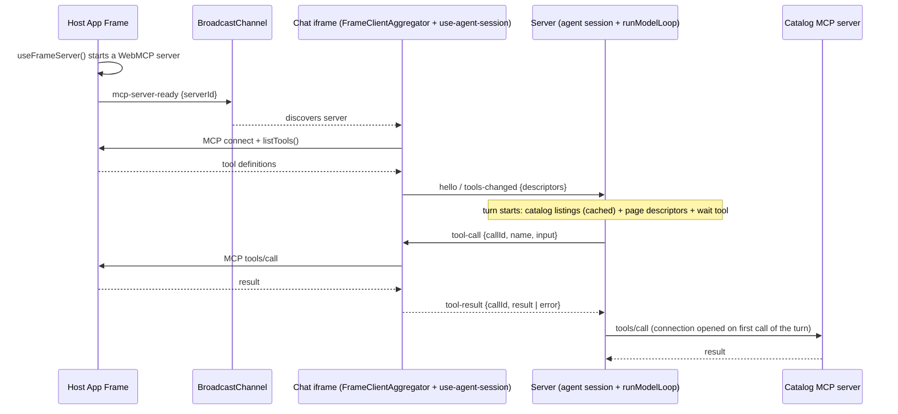
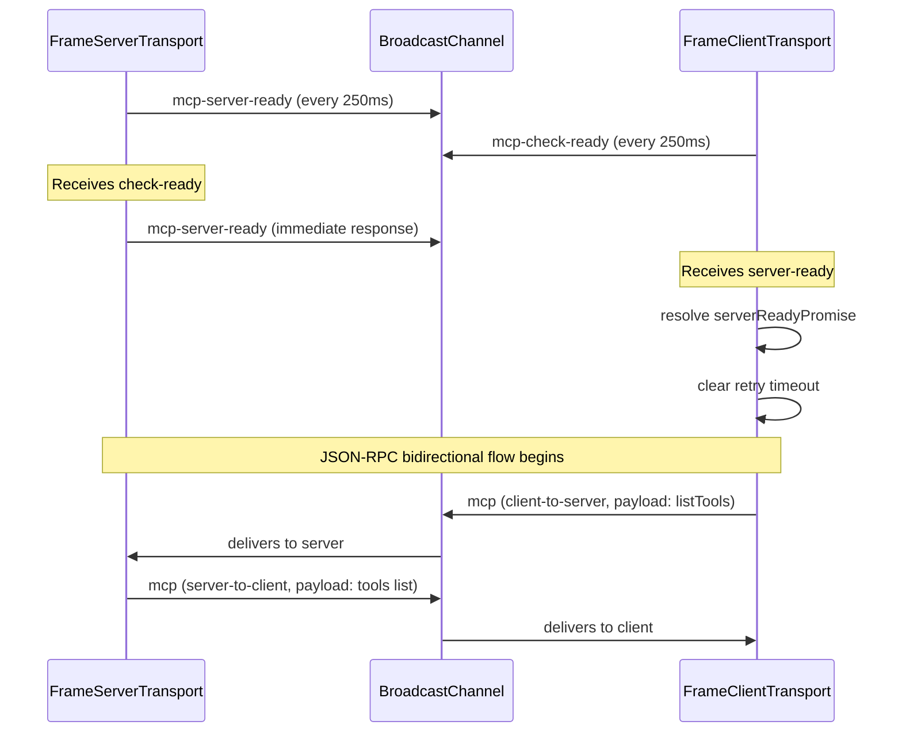
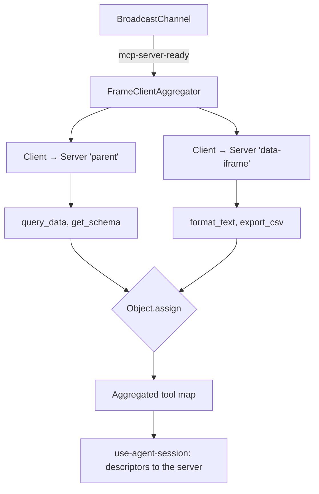

# MCP tool integration

The model runs in **one loop, on the server** (`runModelLoop` in `api/src/conversations/executor.ts`), and every tool it can call reaches that loop as an AI SDK `Tool`. They come from three places:

| Source | Where it executes | Who it acts as |
|--------|-------------------|----------------|
| **Page tools** — declared by the host page through **WebMCP** (`navigator.modelContext`) | in the browser; the server calls them back over the agent-session websocket | the person, with their own browser session |
| **Catalog tools** — the deployment's MCP servers (`config.mcpServers`) | on the server, over MCP streamable HTTP (`api/src/mcp-servers/client.ts`) | a configured agent: its own non-human identity; the personal assistant: the person, via their forwarded session cookie |
| **Loop-provided** — `wait_for_user_action` | on the server: it ends the turn, and the person's next action on the page (from the session's host-event store) starts the next one | — |

Once assembled, the loop cannot tell a page tool from a catalog tool: both get the same provenance envelope, and both are called through `execute`. That is the property that lets one loop serve the in-page personal assistant and configured autonomous agents alike.

Page tools are **decoupled from the chat UI**: each frame declares its tools through WebMCP (the `@mcp-b/webmcp-*` packages), and the project adds a **BroadcastChannel transport** so those WebMCP servers can be discovered across sibling frames of the same origin — which WebMCP, scoped to a single page, does not cover on its own. The chat iframe aggregates them and forwards their *descriptors* to the server; their implementations never leave the browser.

## Overview



**Why BroadcastChannel over postMessage?** No parent/child relationship needed — any frame on the same origin can expose tools. Multiple MCP servers are aggregated into a single tool map. Servers can appear and disappear dynamically.

The rest of this document covers the page side (registration, frame transport, discovery, aggregation), the socket bridge to the server, catalog tools, the live tool set within a turn, and error handling.

---

## 1. Tool Registration

Host application components register tools using `useAgentTool()`:

```typescript
import { useAgentTool } from '@data-fair/lib-vue-agents'

useAgentTool({
  name: 'query_data',
  description: 'Execute a SQL query on the dataset',
  inputSchema: {
    type: 'object',
    properties: {
      sql: { type: 'string', description: 'The SQL query' }
    },
    required: ['sql']
  },
  execute: async ({ sql }) => {
    const rows = await runQuery(sql)
    return JSON.stringify(rows)
  }
})
```

Under the hood (`lib-vue/use-agent-tools.ts`):
1. `initializeWebMCPPolyfill()` ensures `navigator.modelContext` exists (WebMCP standard API)
2. The tool is registered via `navigator.modelContext.registerTool(agentTool)` — a failure (e.g. a duplicate name) is logged as a warning rather than aborting the caller's `setup()`
3. `onScopeDispose()` automatically unregisters the tool when the Vue component unmounts

---

## 2. Frame Server Transport

For tools to be visible across frames, the host frame must expose them via `useFrameServer()`:

```typescript
import { useFrameServer } from '@data-fair/lib-vue-agents'

useFrameServer('parent')  // unique server ID
```

This composable (`lib-vue/use-frame-server.ts`):
1. Creates a `FrameServerTransport` connected to a BroadcastChannel
2. Creates a `BrowserMcpServer` wrapping the existing `navigator.modelContext` (preserving already-registered tools)
3. **Replaces** `navigator.modelContext` with the server — all subsequent `registerTool()` calls go through the MCP server and are automatically exposed via BroadcastChannel
4. On dispose: closes transport, restores original `navigator.modelContext`

---

## 3. BroadcastChannel Protocol

All MCP communication between frames uses a shared `BroadcastChannel` with a tab-specific channel ID (stored in `sessionStorage`, generated by `getTabChannelId()`). This provides tab isolation — multiple browser tabs maintain independent tool namespaces.

### Message Types

```typescript
interface FrameMessage {
  channel: string       // tab-specific channel ID
  type: 'mcp' | 'mcp-server-ready' | 'mcp-server-stopped' | 'mcp-check-ready'
  serverId: string      // unique server identifier
  direction?: 'server-to-client' | 'client-to-server'
  payload?: JSONRPCMessage
}
```

### Discovery Handshake



Both sides retry independently at 250ms intervals until they find each other. Once connected, the client clears its retry timer. The server keeps broadcasting periodically for late-joining clients.

### Server Shutdown

When a frame server closes (frame unmounts), it broadcasts `mcp-server-stopped`. The client transport auto-closes upon receiving this message. A document can also be discarded without any Vue unmount hook running — an iframe removed from the DOM by the host's router, a page navigated away — so `FrameServerTransport` also broadcasts on `pagehide`. A `pagehide` with `persisted === true` is a BFCache entry, not a departure, and is ignored.

This is not just cleanup. A frame server that dies silently leaves its tools in the aggregator's map, and so in the descriptors the server holds. Every turn's sub-agent discovery calls each page-declared `subagent_*` tool over the socket *before the first model call* (see [Sub-Agent Orchestration](./sub-agents.md)); routed to a dead frame, that call waits out the server's `BROWSER_CALL_TIMEOUT_MS` (30s), and any other dead tool fails only when called, after the same wait. The original symptom, under the in-browser loop, was visiting the portals manager, navigating to a dataset page, then any prompt hanging.

### Message Validation

Both transports validate incoming JSON-RPC messages with `JSONRPCMessageSchema.safeParse()`. Invalid messages trigger the `onerror` callback without crashing the transport.

---

## 4. Aggregation (in the chat iframe)

The chat iframe runs a `FrameClientAggregator` (`ui/src/transports/frame-client-aggregator.ts`, started by `use-session-chat.ts` on the per-tab channel) that discovers and connects to all available frame servers:



For each discovered server:
1. Creates a `FrameClientTransport` targeting that `serverId`
2. Creates an MCP `Client` with a `ToolListChangedNotification` handler
3. Connects and waits for `serverReadyPromise`
4. Calls `client.listTools()` to fetch available tools
5. Wraps each MCP tool as an AI SDK `tool()` whose `execute` issues `tools/call` to that frame
6. Merges all tools from all servers into a single map (name collisions: last-write-wins, `Object.assign`)
7. Calls `onToolsChanged(aggregatedTools)`, which sends the new descriptors to the server (`tools-changed`)

The wrapper issues `tools/call` through `client.request(…, CallToolResultSchema)` rather than `client.callTool()`: the latter also validates `structuredContent` against the tool's declared `outputSchema`, but `formatMcpToolResult` (`shared/tool-result.ts`) discards `structuredContent`, so that check could only reject an otherwise usable call over a value that is thrown away. The catalog client on the server makes the same choice for the same reason.

### Dynamic Lifecycle

| Event | Aggregator response |
|-------|-------------------|
| `mcp-server-ready` (new) | Connect, list tools, merge |
| `mcp-server-ready` (known) | Ignored (already connected) |
| `mcp-server-stopped` | Disconnect client, remove tools, re-merge |
| `tools/list_changed` notification | Re-fetch tools from that server, re-merge |

Every re-merge ends in a `tools-changed` frame, so the server always holds the page's current declaration.

---

## 5. The socket bridge

The browser talks to the server over a websocket at `/api/agent-session` (protocol in `shared/agent-session-protocol.ts`; browser half in `ui/src/composables/use-agent-session.ts`, server half in `api/src/agent-session/`).

- **Declaring.** `hello` carries the page's tool descriptors (name, description, raw JSON input schema — `toDescriptors` unwraps the AI SDK's `jsonSchema()` wrapper, which would otherwise serialise to nothing useful). `tools-changed` replaces them wholesale. A reconnect re-declares, because the page may have navigated while the socket was down.
- **Calling.** `browserToolSet` (`api/src/agent-session/browser-tools.ts`) turns each descriptor into a `Tool` whose `execute` is `session.callBrowserTool(name, input)`: a `tool-call` frame with a fresh `callId`, resolved by the matching `tool-result`. The browser runs the aggregated tool and answers with either `result` or `error` — never a failure disguised as a result.
- **Host events ride back.** Events the call caused are drained from the session's host-event store and appended to the tool's result, so the model sees the consequence of its action where it happened. See [Host events](./host-events.md).

Only the descriptors cross the socket. A page tool's implementation is the page's and never leaves the browser.

---

## 6. Catalog MCP tools (server-side)

`openAutonomousAgentTools` (`api/src/mcp-servers/client.ts`) builds the catalog part of a turn's tool set from the agent's `mcpServers` references, each narrowed by its optional `toolFilter`.

- **Which servers.** A configured autonomous agent uses the servers its admin selected. The personal assistant (`personalAgent()` in `api/src/agent-session/personal-agent.ts`) takes **every** catalog entry, unfiltered: it acts as the person, so their own permissions are already the ceiling.
- **Who it acts as.** Injected as `SiteCredentials` (type in `mcp-servers/operations.ts`, built in `performTurn`; see Sites below): `agentSiteCredentials` for a configured agent (its own non-human identity, exchanged and cached per site), `personSiteCredentials` for the personal assistant (the cookie from the person's socket upgrade — held per connection, never stored; it cannot be refreshed server-side, so its life is the socket's, and it is valid on the socket's site only). A session is only requested when some referenced entry has `auth: 'nhi-session'`.
- **Listings are cached** for `TOOL_LISTING_TTL_MS` (60s) per server and identity (for session-authenticated entries, keyed by who asks — the agent's id, or a hash of the person's session — so two identities never share a listing; not by the session cookie itself, which a configured agent exchanges afresh every turn). A cached listing costs no session exchange: the cookie is asked for only on a miss. Listing on every turn was half of an unloaded turn's time to first token. The cached value is the promise, so turns starting together share one listing; failures are not cached. Servers are listed in parallel.
- **Connections are lazy.** A server is connected on the first call to one of its tools in the turn and the connection is reused by the turn's later calls; the executor closes them all when the turn ends. A turn that calls no catalog tool opens none.
- **Unreachable servers.** For the personal assistant an unreachable entry is an availability event: it is **skipped** (and logged) rather than failing the turn. For a configured agent the selection is deliberate, so a failure **throws** (502 naming the server).
- **`isError` results are rethrown**, so the AI SDK records a `tool-error` part and the model receives `error-text` rather than a failure shaped like data.
- **Annotations** (`readOnlyHint`, `destructiveHint`…) and the originating server travel with each tool (`SourcedTool`, `api/src/conversations/operations.ts`) and are recorded on each stored tool call.

The diagnostic endpoint `GET /api/autonomous-agents/:type/:id/:agentId/tools` goes through the same `openAutonomousAgentTools` with `fresh: true`, which lists **fresh** (bypassing the cache), and returns descriptors only — an admin checking a fix wants the server's answer now.

### Sites

Every call of a catalog entry with `auth: 'nhi-session'` (a stack service) acts on one **site**, because
sessions are host-only (see [Hosts](./overview.md#hosts)). The `SiteCredentials` a turn is given
(`mcp-servers/operations.ts`) says which: a home site, the other account sites (`portals`), and `cookieFor(site)`,
which yields that site's session or nothing. `callHeaders` then sends the site's `x-forwarded-host` and,
when there is one, its cookie; without a cookie the call is anonymous. The agent's credentials come from
`agentSiteCredentials` (`nhi/service.ts`), the personal assistant's from `personSiteCredentials` (its
socket's cookie, valid on its socket's site only, no portals).

When the agent has portals, each site-bound tool's input schema gains an optional `portal` argument
(an enum of the portal hosts) unless the tool declares its own; `splitPortalArgument` removes it before
the call. Naming a host outside the list is a tool error. When the home site is outside the account, the
agent's prompt says it acts anonymously there. Listings and connections are keyed per site (and listings
per credential hash): a connection's headers are fixed when it opens, and what a server lists may depend
on the site and on who asks. `none` and `apiKey` entries are not site-bound and keep one listing and one
connection.

### External MCP servers

An agent may list `externalMcpServers: [{ url }]` (at most 50): public MCP endpoints, another data-fair
portal or any other, which it uses **anonymously** (`api/src/mcp-servers/external.ts`). Only an
organization admin edits the list. URLs are normalized on save (`normalizeExternalMcpServers`: https
assumed, lowercase host, no IP address, no credentials, deduplicated; a 400 otherwise). An `http://` endpoint is accepted when it is listed (or discovered)
explicitly, which dev and intranet setups need; it still goes through the public-address guard below,
and `https` is expected in production.

- **Egress guard.** The connection goes through the web access module's `publicLookup`, so it reaches
  public addresses only (`SSRF_PUBLIC_IPS` and `config.externalMcp.publicIps` declare exceptions) and
  **redirects are refused**: an endpoint cannot be used to reach the service's own network. Nothing
  credentialed is ever sent.
- **Names.** Tools are named `<host slug>__<tool>` (host lowercased, non-alphanumerics folded to `_`, 30
  characters, 64 in all), so they collide neither with catalog tools nor with each other; the recorded
  server is the host.
- **Bounds.** Connecting and listing a server share a 15 s timeout, so a slow one does not delay every
  turn. A run makes at most 50 external calls across all of them.
- **Failures are skipped and reported** (`skippedServers`), never fatal: the organization chose the
  server, not the operator, and it lives outside the platform. Connections are opened per turn and closed
  with it, along with the egress dispatcher. An `isError` result is rethrown as for a catalog tool.
- **Trust.** Allowing a server means trusting its author to, in effect, instruct the agent (it writes the
  tool descriptions the model reads) and that every argument sent leaves the platform: the same model as
  web access's allowlist. Its **self-declared annotations** (`readOnlyHint`, `destructiveHint`) drive the
  approval gate for its tools, as a catalog server's do, so a server that lies about them is trusted
  to that extent.
- **`request_mcp_access({ url, reason })`** is how an agent asks for one, typically after web access
  reported a site's MCP server. It always stops on an approval card and only an administrator of the
  organization may approve it (`ADMIN_DECISIONS`, as for `request_web_access`). Approved, it saves the
  extended list (refusing beyond the cap); the server's tools exist from the agent's next turn. Never
  offered to the personal assistant, which gets no external servers.

### Assembly and provenance

The executor (`performTurn`) merges the catalog tools, the page tools (when a socket watches the conversation) and `wait_for_user_action` (only when someone is there to act), in that order — a page tool overrides a catalog tool of the same name. Both catalog and page results are wrapped by `withProvenance` (`api/src/conversations/operations.ts`) in a `<tool-result server="…" tool="…">` envelope marking them as untrusted data; a page's server name is the fixed `the-page`, never its URL. Thrown failures are wrapped too. Sub-agents are then partitioned out (see [Sub-Agent Orchestration](./sub-agents.md)).

### Result formatting

`formatMcpToolResult` keeps the text `content` parts (and prefixes `isError` results with `Tool execution failed:`); `structuredContent` is dropped. Text-only results stay a plain string. A result carrying MCP `image` parts becomes a **media envelope** (`{_agentsMediaResult: true, text?, media: [{data, mediaType}]}`); `withProvenance` wraps only its text and keeps the object shape.

Nothing on the server currently rebuilds that envelope into image parts: the gateway's `convertOpenAIMessages` that did so is gone with the gateway, and the executor gives the tools no `toModelOutput`, so the AI SDK hands the envelope to the provider as JSON — base64 included. The redaction helpers in `shared/tool-result.ts` (`redactHistoryMediaToolResults`) are likewise no longer called from `api/src`.

---

## 7. The tool set is live within a turn

A page's tools change *while a turn runs* — the agent calls a tool that opens a panel or navigates, and the newly mounted components register their own tools. The agent must be able to call them in the **same** turn, or it concludes it is stuck.

Two facts make this work without restarting the stream:

1. **`streamText` does not snapshot `tools`.** It re-reads the object it was given at every step — to build the list advertised to the model and to look up `tools[name]` at call time. So `runModelLoop` hands it a `liveTools` map and **mutates it in place**: in `prepareStep`, if the page's tool *names* have changed since the last assembly, the page part is rebuilt from the session's current descriptors over the fixed part (catalog + wait tool), and the sub-agent partition is re-run on the result. Replacing the object would do nothing. Re-assembly is keyed on names only, because each pass reads every sub-agent's config over the socket.

2. **The update must land before the next step is built.** The registration, the `tools/list_changed` notification and the aggregator's re-list all complete *after* the tool's own result unless something orders them. So the browser holds the result back:

```mermaid
sequenceDiagram
  participant Loop as runModelLoop (server)
  participant Chat as Chat iframe (aggregator)
  participant Host as Host frame

  Loop->>Chat: tool-call open_panel
  Chat->>Host: tools/call
  Host->>Host: panel mounts, registers set_display
  Host--)Chat: notifications/tools/list_changed
  Host-->>Chat: tools/call result
  Note over Chat: settled(): fold the re-list in FIRST
  Chat->>Loop: tools-changed (+ set_display)
  Chat->>Loop: tool-result
  Loop->>Loop: prepareStep sees new names, rebuilds liveTools
```

- `FrameClientAggregator.settled()` resolves once every in-flight `tools/list_changed` refresh has been folded in (and `onToolsChanged` has sent `tools-changed`). The tool wrapper awaits it before returning. This is ordering, not a timing guess: the host registers its tools *during* its own execution, so the notification is on the channel before the result, and BroadcastChannel delivery is FIFO per channel.
- The `tools-changed` frame is therefore sent before the `tool-result` frame on the same socket, so the server's descriptors are current by the time the call resolves and the next step is prepared.
- Cross-frame changes that no tool call caused (a frame appearing on its own) are picked up too, just without the ordering guarantee — on whichever step comes next.

The behaviour is exercised end to end by `tests/features/chat-mcp/3.live-tools.e2e.spec.ts` (the `_dev/chat-live-tools` page).

> Every tool is offered on every step. The former opt-in **exploration mode** (progressive disclosure through `explore_tools`) belonged to the in-browser loop and is not implemented server-side — see [Tool exploration](./tool-exploration.md).

---

## 8. Error Handling

| Layer | Mechanism |
|-------|-----------|
| **Frame transport** | `JSONRPCMessageSchema.safeParse()` validates messages; invalid ones trigger the `onerror` callback. Sending on a stopped transport throws. |
| **Aggregator** | Connection failures are logged and the server is removed. Tool listing failures are logged but the server is retained (retried on next `tools/list_changed`). |
| **Browser side of the socket** | A call for a tool the page does not have, or whose `execute` throws, is answered with `tool-result { error }`. Calls are served concurrently, so the parallel calls of one step run at once. |
| **Server side of the socket** | `callBrowserTool` rejects — never hangs — when the page does not currently advertise the tool, after `BROWSER_CALL_TIMEOUT_MS` (30s), on a browser-reported error, and when the socket closes. |
| **Catalog** | Listing failure: skip (personal assistant) or 502 (configured agent); not cached. Connect failure at call time: error naming the server, retried on the next call. `isError`: rethrown as a tool error. |
| **Loop** | Tool failures become `tool-error` parts the model sees as `error-text`. Step limits, repeated-call and budget guards, and the stream's idle/total timeouts are in [Loop guards](./loop-guards.md). |

---

## Execution context & safety

Every tool runs with an identity no broader than the actor the loop stands for:

- **Page tools** execute in the person's browser, with exactly their session. A tool can do nothing the person could not already do.
- **Catalog tools** for the **personal assistant** are called with the person's forwarded session cookie, so the upstream service applies the person's own permissions.
- **Catalog tools** for a **configured agent** are called as that agent's non-human identity, whose permissions an admin granted when enrolling it.

A prompt injection or a compromised tool descriptor therefore cannot escalate beyond that identity. Results from both sources are treated as untrusted data via the provenance envelope, and the system prompt tells the model to respect it.

Page tools are deliberately **assistive / non-destructive**: no generic HTTP client, no arbitrary-code executor — only well-defined actions over page content or read-only endpoints. At most a page tool *prepares* an action (e.g. pre-fills a form), and the write is performed by the person. Catalog tools are not bound by that convention; their MCP annotations (`readOnlyHint`, `destructiveHint`) are recorded per call so writes are auditable, and are surfaced by the diagnostic endpoint before an agent ever runs. A tool call that slips through on a moderation fail-open before a late block lands is discussed in [moderation](./moderation.md).

---

## End-to-End Data Flow

```
Registration (browser):
  useAgentTool() → navigator.modelContext.registerTool()
    → BrowserMcpServer → FrameServerTransport
      → BroadcastChannel (mcp-server-ready)

Discovery (browser → server):
  FrameClientAggregator → FrameClientTransport
    → BroadcastChannel (mcp-check-ready / mcp-server-ready)
      → MCP Client.connect() → Client.listTools()
        → AI SDK tool() wrappers → onToolsChanged()
          → socket: hello / tools-changed {descriptors}

Turn assembly (server):
  performTurn → openAutonomousAgentTools (cached listings, lazy connections)
    + browserToolSet(session) + wait_for_user_action
      → withProvenance → partitionSubAgents → liveTools → streamText

Execution, page tool:
  LLM tool-call → liveTools[name].execute() → session.callBrowserTool()
    → socket: tool-call → aggregator tool.execute() → MCP tools/call over BroadcastChannel
      → registered tool.execute() → CallToolResult → formatMcpToolResult
        → settled() → socket: tool-result → + host events → provenance envelope → LLM

Execution, catalog tool:
  LLM tool-call → execute() → (connect on first call) → MCP tools/call over HTTP
    → formatMcpToolResult → provenance envelope → LLM
```
