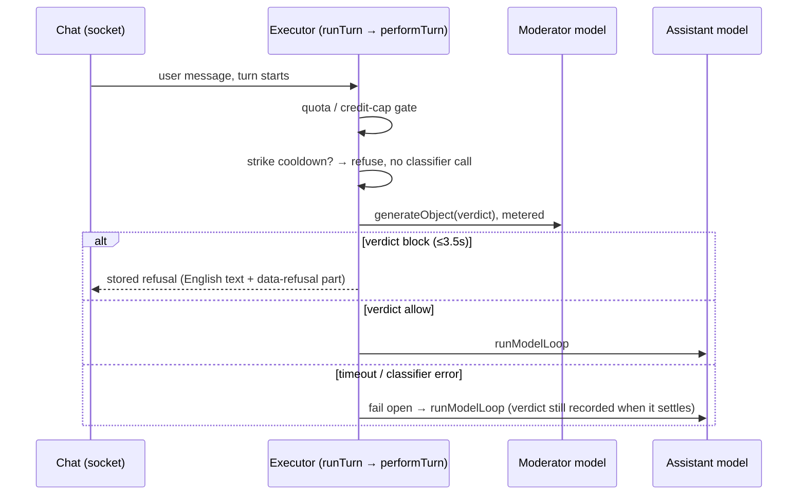

# Input moderation guard

A per-message guard protects the platform from abuse — profanity, prompt-injection attempts, persona override, and using the assistant as a free general-purpose tool unrelated to the platform's data (general chatbot use, essays, writing substantial general-purpose software). The off-scope criterion is scoped to that misuse: data exploration/analysis/visualization, working with dataset and file content, small scripts that consume the platform's data or API, authoring the metadata of the platform's own resources, and delegated sub-agent tasks all stay in scope even when detailed or technical, so legitimate work is not blocked as off-platform. Writing general-purpose code is out of scope, but a small data/API-consuming script is allowed, and the ambiguous middle resolves to allow. Moderation is **opt-in per organization**: an org admin enables it and chooses which user categories it applies to (any of `anonymous`, `external`, `user`, `contrib`, `admin`; default `anonymous` + `external`) through `settings.moderation` (`PUT /api/settings/:type/:id/org`). It is off by default; categories that aren't selected are never checked — zero cost, zero latency for them. The category is the role of the **person who wrote the message** (`speakerIdentityFor`, `api/src/conversations/operations.ts`), also for a configured agent's chat: that turn bills as the agent, with role `admin` so no per-profile quota applies, but an instructor from a partner organization or from outside is `external` and is judged — and struck — as themself, not as the agent everyone shares.

**A gate in front of the server loop.** Moderation is one of the turn gates (`api/src/conversations/turn-gates.ts`) that `performTurn` (`api/src/conversations/executor.ts`) runs before any model call, after the quota/credit gate: a refused turn must cost nothing beyond the classifier itself. It applies to every agent that runs on the executor — the in-page chat's personal assistant and configured autonomous agents alike. Whether it applies is decided by the pure helper `moderationApplies(settings, role)` (`api/src/moderation/operations.ts`), on the role of the turn's usage identity (`usageIdentityFor`): the person's effective role for the personal assistant (`anonymous` for a socket-scoped anonymous visitor), `admin` for a configured autonomous agent, which bills as itself (see [quotas-usage](./quotas-usage.md) for role resolution).

**What is judged.** `moderateTurn` reads the last 6 stored messages of the conversation; the latest user message (truncated head+tail) is the judged unit, and the earlier turns form a bounded, reference-only **conversation-context block**, isolated from it by `<conversation_context>` / `<message_to_moderate>` wrappers so brief follow-ups are read in context without becoming judgeable themselves. The classifier is prompted with a **generic server-side mission**, never the agent's own instructions. Only the lead turn's user message is checked: tasks the lead delegates to sub-agents are not classified. The `moderator` role resolves **moderator → summarizer → assistant** via `resolveRoleModel()` (`api/src/models/service.ts`, wrapping `getRoleModel()`'s fallback-chain walk in `api/src/models/operations.ts` — see [Configuration → Role resolution](./configuration.md#role-resolution-the-catalog)); the call is made with reasoning disabled where the provider supports it, so a thinking model does not spend its tiny output budget on hidden reasoning.

**A blocking pre-check, bounded.** The verdict is awaited before the model is called (`startModeration` in `api/src/moderation/service.ts`). The wait is bounded by `MODERATION_TIMEOUT_MS` (3.5s): past it, or on a classifier error, the gate **fails open** and the turn proceeds — the guard must not take the service down with it. The classifier call keeps running under a hard 30s cap so every check eventually settles and writes exactly one event; a block that arrives after the gate opened is recorded as `late-block` (and still counts as a strike) but no longer stops the turn, which has moved on.

**Refusals are stored answers.** A blocked turn finishes with stop reason `completed` and an assistant message holding the English `MODERATION_REFUSAL` text plus a `data-refusal` part (`{ kind: 'moderation' }`). The model, review and the export read the text; the chat renders its own localized sentence from the part (`AgentChat.vue` `formatRefusal`). The blocked user message and the refusal stay in the conversation like any other turn.

**Strikes (untrusted only).** The gate blocks individual messages for every moderated category, but the strike/cooldown lockout is an anti-abuse measure reserved for **untrusted** callers (anonymous/external): only their blocks accrue strikes, and only they can be cooldown-refused. A moderated trusted member (e.g. an org `user`/`contrib`) gets each abusive message blocked but is never locked out. 5 blocks within 24h arm a 1h cooldown (`moderation-strikes` collection, keyed by the usage identity `anon:<ip-hash>` / user id, TTL 48h) during which the caller is refused without any classifier or model call.

**Spend.** The classifier call is recorded in the usage ledger under model role `moderator`, added to the run's credits and recorded in the run's per-call telemetry (`runs.calls`), so a blocked turn shows what it cost. A late verdict is in the ledger only.

**Observable by construction.** Every check writes exactly one event to `moderation-events` (TTL 30 days, `RETENTION_SECONDS` in `api/src/retention.ts`): `allow`, `block`, `late-block`, `fail-open-timeout`, `fail-open-error`, or `strike-refusal`, with verdict latency. Only block events keep a ~500-char message excerpt (the review payload). Admin-only endpoints (`/api/moderation/:type/:id/stats|events|probe`, `api/src/moderation/router.ts`) and a section on the activity page expose totals, fail-open rate (with a >20%/24h warning banner), recent blocks, and a live 3-message test probe. Stats use MongoDB's `$percentile` (requires MongoDB ≥ 7.0).

**Probe.** The admin activity page can run a one-off check against the moderator model via `POST /api/moderation/:type/:id/probe` (`runProbe`): it sends 3 canned messages directly to the moderator model, is metered at account level, and writes **no** events — so stats reflect only real traffic. It is independent of the gate (no strikes).

**The events collection is the record of verdicts.** The conversation shows that a turn was refused; the verdict's category, reason, latency and fail-open cause live only in `moderation-events`. So moderation is read from the moderation stats and events endpoints, not from [conversation review](./conversation-review.md).

**Input only (v1).** No output moderation, no tool-result / indirect-injection coverage, no multi-turn jailbreak detection. The `/api/summary` endpoint is not verdict-checked, but it shares the moderation posture for **untrusted** callers: strike cooldowns apply, and its system prompt is pinned server-side for every caller (a caller-supplied prompt would be an unmoderated jailbreak vector). On a fail-open turn the model runs, tools included, without a verdict; tools act with the identity the agent runs as — the person's own session for the personal assistant, the agent's non-human identity for a configured one (see [mcp-tools](./mcp-tools.md) and [autonomous agents](./autonomous-agents.md)).
