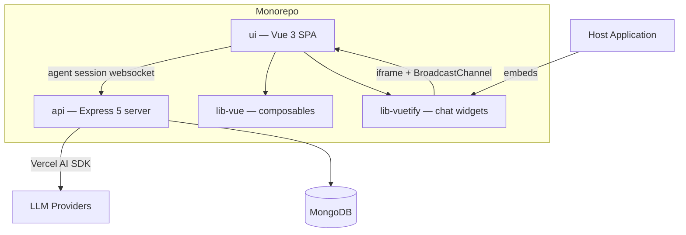

# Architecture overview

**data-fair/agents** is a multi-provider AI chat service with tool-use capabilities, designed to be embedded into data-fair applications. The agent loop runs on the server, which also holds the conversation; the browser renders it and contributes page tools. It provides a websocket agent session, server-side orchestration with sub-agents, and an embeddable chat widget.

| Workspace | Role |
|-----------|------|
| `api/` | Express server: the agent loop and conversation store, the agent session socket, settings, quotas and usage, moderation, review, summarization |
| `ui/` | Vue 3 + Vuetify 4 SPA: the chat (rendering the turn the server streams, gathering the page's tools for it), settings and review pages |
| `shared/` | What both the server and the browser read: the agent session protocol, host events, message parts, consent — and nothing else (a unit test enforces that every module has a UI consumer) |
| `lib-vue/` | Vue composables: WebMCP tool registration, sub-agent declaration, BroadcastChannel transport |
| `lib-vuetify/` | Embeddable Vuetify components: chat drawer, menu, action button, toggle FAB |
| `lib-sim/` | The scenario-simulation harness (`npm run simulate`) and the dev bridge to Claude Code models |

Every conversation runs on ONE loop, on the server (`api/src/conversations/executor.ts`): the in-page
chat's personal assistant and configured [autonomous agents](./autonomous-agents.md) alike. The chat
talks to it over the agent session websocket (`shared/agent-session-protocol.ts`): it sends prompts and
its page's contextual tools, and receives the stored turn as it is written, plus calls to those tools.
The frames are JSON schemas like every other boundary (`shared/agent-session-client-frame`, validated;
`shared/agent-session-server-frame`, typed), and an `error` frame carries the HTTP status its refusal
would have had.

A conversation starts one way, for everyone: the socket's `hello` names the account and the agent, and
the first prompt creates the thread (`createConversation`), carrying its title — opening a chat creates
nothing.
A signed-in person's conversations are stored and theirs to come back to. An **anonymous visitor's**
thread is stored only for the loop's sake: the socket that created it is the only one that can use it,
and it is purged when that socket closes (`purgeAbandonedAnonymous` sweeps one whose close never ran).
Their turns are charged per IP, in the untrusted pool — see [Quotas & usage](./quotas-usage.md).

AI provider/model configuration and credit-based quotas are layered across deploy-time env vars, per-org superadmin definitions, and org-admin distribution — see [Configuration](./configuration.md).

## The other documents

| Concern | Read |
|---|---|
| A turn's tools: page tools over the socket, the MCP catalog, `wait_for_user_action` | [MCP tool integration](./mcp-tools.md), [Host events](./host-events.md) |
| What the model is sent, and how a long conversation is kept within its window | [Context management](./context-management.md) |
| What stops a turn: step and repetition guards, budgets, the clock | [Loop guards](./loop-guards.md) |
| Delegating to workers | [Sub-agent orchestration](./sub-agents.md) |
| Configured agents with their own identity | [Autonomous agents](./autonomous-agents.md) |
| What an agent remembers across conversations | [Agent memory](./agent-memory.md) |
| Prompts an agent runs on a schedule, unattended | [Planned tasks](./planned-tasks.md) |
| Providers, models, roles | [Multi-provider AI abstraction](./providers.md), [Configuration](./configuration.md) |
| Who may spend what, and what it cost | [Quotas & usage](./quotas-usage.md) |
| Refusing abusive input | [Input moderation guard](./moderation.md) |
| What an admin may read back | [Conversation review](./conversation-review.md) |
| Putting the chat in a host application | [Embedding](./embedding.md), [Integration context](./integration-context.md) |
| Shelved | [Progressive tool disclosure](./tool-exploration.md) |
