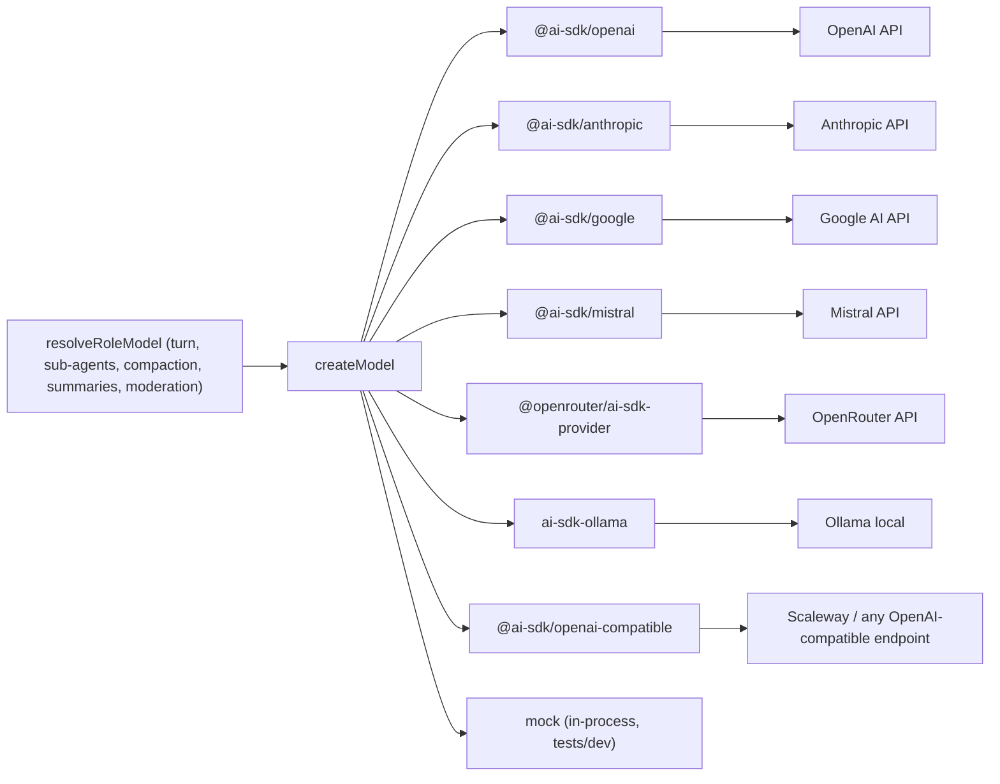

# Multi-provider AI abstraction

The system supports **9 provider types** through a unified factory (`createModel()`, `api/src/models/operations.ts`) built on Vercel AI SDK 7 (see [AI SDK version](#ai-sdk-version)).

`scaleway` is its own provider `type` but is routed through `@ai-sdk/openai-compatible` (see `scalewayBaseURL()` and the comment on `createModel()`), same as `openai-compatible` in `compatibility: 'compatible'` mode — both need `reasoning_content` captured, which `@ai-sdk/openai`'s `/v1/responses` client drops.

**Settings map 4 roles to concrete models** (`resolveRoleModel`, `api/src/models/service.ts`; every model call is made server-side):

| Role | Purpose |
|------|---------|
| `assistant` | Primary conversational model |
| `tools` | Structured data / tool-calling specialist; default seat for sub-agent workers |
| `summarizer` | Context compaction, conversation summaries |
| `moderator` | Input moderation guard (internal, server-side) |

There is no per-role fixed cost ratio. Each model in the catalog (global `MODELS` or an org's `settings.models`) carries its own prices per token class — fresh input, cached input, output — in euros per million tokens, and credits come from actual token counts against those prices divided by the credit peg; see [Configuration → Credits](./configuration.md#credits) for the formula. A cheaper role like `summarizer` is typically *mapped* to a cheaper model, but nothing in the schema ties a role to a fixed ratio.

Each owner (user or organization) may add its own providers and models on top of the deployment-wide catalog — see [Configuration](./configuration.md) for the full env-var / superadmin / org-admin layering. API keys are **encrypted at rest** (AES-256-CBC) and obfuscated in API responses for org-owned providers (the deployment-wide `PROVIDERS` env var is plain text, since it never leaves the deployment's own secret store).

`GET /api/models/:type/:id` (`api/src/models/router.ts`) lists the *raw* models each of the org's own `settings.providers` actually offers upstream (used by the superadmin form's model-picker when adding an entry to `settings.models`) — it only queries an org's own providers, not the global `PROVIDERS`. Results are memoized for **5 minutes**, keyed by `owner:updatedAt` so a settings change busts the cache.

Each catalog entry may carry a **context window** (tokens). It sizes history
compaction, which only ever applies to the assistant seat, but it describes the
model rather than the role, so any entry may set it. Left empty it falls back to
whatever the model listing reported when the model was picked — only OpenRouter
and the mock provider report a context length today; everything else, Ollama
included, falls back to a 128000-token default sized for frontier assistant
models. See [Context management](./context-management.md) for how it feeds
the budget.

Cache reads are charged at their own rate, not at the fresh-input rate — the
reason prices are per token class at all. Left empty, a model's cache price falls
back to its input price (*unknown*, never *free*), which is what most entries do:
the reference model is the only one in the Scaleway catalog publishing a cache
tariff. Cache **writes** bill at the plain input price; there is no write tariff
to configure. Only Anthropic reports writes (at 1.25× input, so they are slightly
under-billed), and only on the calls below.

### Prompt caching

Most providers cache an identical prompt prefix **on their own**, with nothing in the request:
OpenAI, Gemini (implicit caching), DeepSeek, and vLLM-style servers behind `openai-compatible`
(measured on GreenPT and Scaleway with `dev/bench-prompt-cache.ts`). **Anthropic caches only when a
request asks for it.**

The calls that send a growing prefix again ask, by passing `CACHED_PREFIX_PROVIDER_OPTIONS`
(`api/src/models/operations.ts`): the lead loop's steps (`model-loop.ts`), sub-agent workers
(`sub-agents.ts`) and memory consolidation (`memory/consolidation.ts`). It is
`{ anthropic: { cacheControl: { type: 'ephemeral' } } }`, a request-level option that
`@ai-sdk/anthropic` sends as Anthropic's top-level `cache_control` — automatic mode: the cache point
is the request's last block, so each step reads what the previous step wrote, and a request never
exceeds the four explicit cache points Anthropic allows. Other providers ignore the `anthropic` key,
so the call sites pass it whatever the provider.

One-off calls do **not** ask — compaction, the conversation title, the summary route, the sub-agent
close-out, moderation: an Anthropic cache write costs 1.25× the input price and they would not read
it back, and not asking is how an Anthropic call stays out of the cache. Cache reads and writes come
back in `usage.inputTokenDetails` and are charged by `priceTokensBreakdown`.

Not done: cache points for Claude models reached through OpenRouter (it needs its own markers),
OpenAI's optional `promptCacheKey` routing hint, and a separate cache-write price.

## AI SDK version

`ai` is pinned **exactly** (7.0.137), and so is every provider package, at the versions published with it: `@ai-sdk/anthropic` 4.0.78, `@ai-sdk/google` 4.0.93, `@ai-sdk/mistral` 4.0.62, `@ai-sdk/openai` 4.0.91, `@ai-sdk/openai-compatible` 3.0.67, `@ai-sdk/provider` 4.0.26, `@openrouter/ai-sdk-provider` 3.1.0, `ai-sdk-ollama` 4.4.0. Two reasons, both measured:

- `@ai-sdk/code-mode` (1.0.94, the code-mode tool), is released in lockstep with `ai` and peer-pins one exact version: `@ai-sdk/code-mode@1.0.94` ↔ `ai@7.0.137`. A range would let `ai` drift away from it on an ordinary install.
- The tree must hold **one** `@ai-sdk/provider-utils`. Installed without `npm dedupe`, each provider nests its own copy of the same version, and a `Tool` from one copy does not type-check as a `Tool` from another (31 type errors instead of 7 during the upgrade). After any bump: `npm dedupe`, then `npm ls ai @ai-sdk/provider-utils` must show a single version of each.

What this service relies on in AI SDK 7, and where each is pinned by a test against the real SDK:

| Behaviour | Relied on by | Pinned in |
|---|---|---|
| Each step's tools are built from the `tools` object after `prepareStep`, so a map mutated in place is live | `runModelLoop`'s `liveTools` (`api/src/conversations/model-loop.ts`; [MCP tools §7](./mcp-tools.md#7-the-tool-set-is-live-within-a-turn)) | `tests/features/autonomous-agents/live-tool-set.unit.spec.ts` |
| A `prepareStep` `messages` override carries forward to later steps | `loopGuardPrepareStep` rebuilds each step instead of appending ([loop guards](./loop-guards.md)) | `tests/features/chat-subagent/loop-guards.unit.spec.ts` |
| `result.response.messages` is the final step's only; `result.responseMessages` is all of them | the sub-agent close-out ([sub-agents §3](./sub-agents.md#loop-guard-close-out)) | `tests/features/agent-session/sub-agents.unit.spec.ts` |
| A step's tools run only after the model call ends (`model-call-end`, `execute-tools-from-stream.ts`), not as each call streams in: a small latency change | the activity-label comment in `runModelLoop` (`api/src/conversations/model-loop.ts`) | none (read from the SDK source) |
| `@ai-sdk/openai-compatible` reads provider options under the camelCase name (`openaiCompatible`) | the moderator's `reasoningEffort: 'none'` | `tests/features/models/models.unit.spec.ts` |
| `@ai-sdk/anthropic` sends a request-level `cacheControl` as the top-level `cache_control`, and reports cache reads in `inputTokenDetails` | [prompt caching](#prompt-caching) on the loops | `tests/features/models/models.unit.spec.ts` ("prompt caching options") |
| A v3 model (the mock) receives a tool's image as `file-data` with an `image/*` media type | the mock's `what did you see` seam | `tests/features/models/models.unit.spec.ts` |
| An abort cancels the model stream | the mock model clears its timer when cancelled, instead of writing to a closed stream and crashing the server (`api/src/models/mock-model.ts`) | `tests/features/agents/mock-model.unit.spec.ts` ("a stream cancelled mid-text stops pushing, instead of crashing the process") |
| An abort signalled to a `ToolLoopAgent` is honoured **between steps** | a sub-agent worker crossing the run's credit budget is stopped, not left to run to its step limit ([sub-agents](./sub-agents.md#billing-and-ceilings)) | `tests/features/agent-session/sub-agents.api.spec.ts` |
| An abort ends an in-flight tool call immediately | a stopped turn does not wait for a slow MCP call; the remote side may still complete, so the stored error says the outcome is unknown ([approval gate](./autonomous-agents.md#the-approval-gate)) | `tests/features/autonomous-agents/approval-gate.api.spec.ts` (a person speaking while `slow_lookup` runs: the run ends at once with the outcome unknown, and the remote side still completes) |
| An approved call whose tool is gone is silently skipped | `toolApproval: denyGoneApprovedTools(...)` (`api/src/conversations/approved-calls.ts`) denies it by name, so it is settled `output-error` rather than left open | `tests/features/autonomous-agents/approved-calls.unit.spec.ts` |

Deliberately **not** migrated, because v7 still runs them unchanged and migrating would change behaviour: `generateObject` (moderation), `needsApproval` on tools (the approval policy), and the `image-data` / `file-data` tool-result parts of `mediaModelOutput`. The SDK auto-migrates the parts at runtime, and each of the three logs a single `DeprecationWarning` per process. They move with the work that owns them.

Source: [Migrate AI SDK 6.x to 7.0](https://ai-sdk.dev/docs/migration-guides/migration-guide-7-0).
