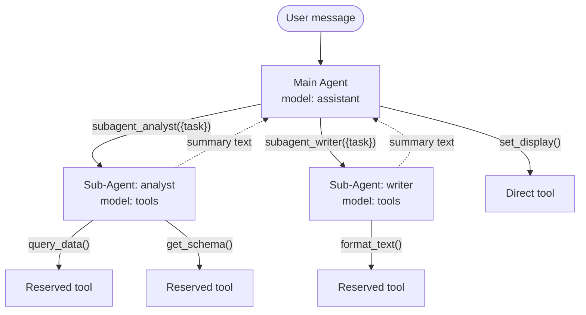
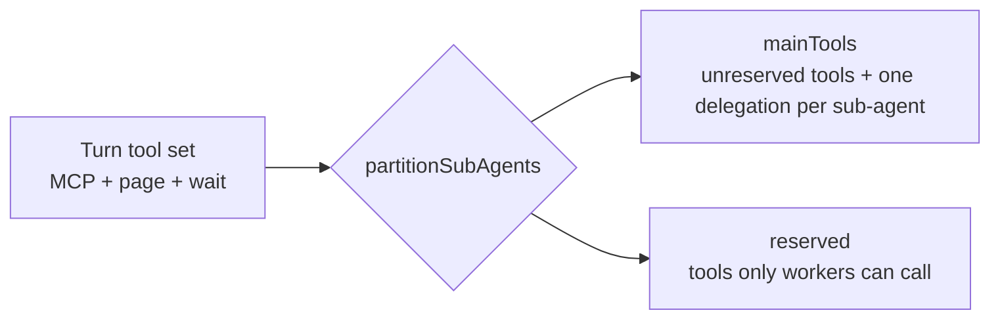
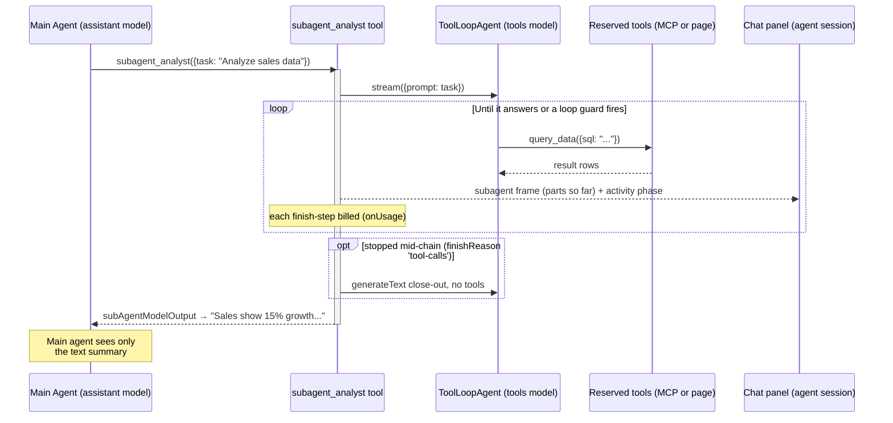
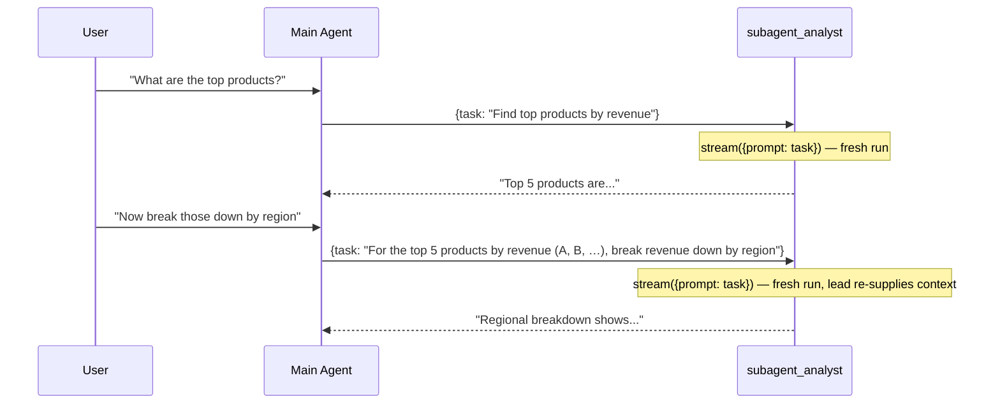

# Sub-agent orchestration

The orchestrator-worker pattern runs **on the server**, in the same loop as the lead. The main agent delegates tasks to specialized sub-agents via pseudo-tools (`subagent_*`), each backed by a `ToolLoopAgent` from Vercel AI SDK v6.

It moved with the loop, and not as a choice: a worker is a model loop, and the only way a browser reached a model in the old architecture was the gateway, so "the gateway goes" and "workers move server-side" were one decision. `api/src/agent-session/sub-agents.ts` holds the partition and the delegation; `runModelLoop` in `api/src/conversations/executor.ts` builds them per turn.



At a glance:

1. **Registration** — Page components call `useAgentSubAgent()` (lib-vue), which registers a `subagent_*` browser tool whose `execute` returns a JSON config (prompt, tool list, model role) instead of a result.
2. **Partitioning** — `partitionSubAgents` splits the tool set: each `subagent_*` tool is called once to read its config, its reserved tools are removed from the main set, and it is replaced by a delegation. A tool whose config cannot be read is dropped rather than offered, since calling it would hand the model a config where it expects a result. The config read goes through the ordinary tool path — a socket round trip to the page — so it arrives inside the provenance envelope and is unwrapped before parsing, and it is called with `{ task: '' }` because a page declares `task` as required and validates against its own schema.
3. **Execution** — Each sub-agent gets a `ToolLoopAgent` instance with its own tool set and system prompt, on the **`tools` seat** by default; a config may pin a role instead (`assistant`, `tools` or `summarizer`; anything else falls back to `tools`), which is honoured because the value names a role and not a model, so which model serves it stays the organization's choice. Every worker step is billed — against the run's credit budget, the account's credit cap and the usage histogram — and recorded as its own entry in the run's `calls` under its seat, because the spend happens inside a tool's `execute` where the lead's own accounting cannot see it. A ceiling crossed mid-delegation aborts the worker rather than waiting for its step limit. It runs under the [loop guards](./loop-guards.md): a flat 100-step backstop plus a repeated-call guard that stops at 5 identical steps. Sub-agents run **concurrently** when the main agent requests several in one step, since the AI SDK executes the tool calls of a step in parallel. Each call streams into its own panel, keyed by the delegating `toolCallId`.
4. **Stateless workers** — Each delegation is a fresh, single-shot run: the worker keeps no conversation history across calls. The lead holds the state and re-states all needed context in the `task` field.
5. **Context reduction** — The main agent sees only a compact text summary (`subAgentModelOutput`). The worker's trace is streamed to the chat panel as `subagent` frames and never reaches the lead.

The rest of this document expands each of these mechanics in turn.

---

## 1. Registration

Host application components declare sub-agents using `useAgentSubAgent()` (`lib-vue/use-agent-sub-agent.ts`):

```typescript
useAgentSubAgent({
  name: 'analyst',
  title: 'Data Analyst',
  description: 'Analyzes datasets and produces insights',
  prompt: 'You are a data analyst. Use the provided tools to query and analyze data.',
  tools: ['query_data', 'get_schema'],
  model: 'tools'  // optional, defaults to 'tools'
})
```

This registers a pseudo-tool named `subagent_analyst` via `useAgentTool()`. The page reports it to the server like any other contextual tool (the `hello` / `tools-changed` frames of the agent session), and its `execute()` returns a static JSON config:

```json
{ "prompt": "You are a data analyst...", "tools": ["query_data", "get_schema"], "model": "tools" }
```

The config is not used directly by the LLM — it is consumed by the server loop to bootstrap the sub-agent.

---

## 2. Tool Partitioning

Before the first step of a turn, `runModelLoop` calls `partitionSubAgents()` over the turn's whole tool set — the catalog's MCP tools, the page's tools and the loop-provided wait tool — so a worker may reserve MCP tools as well as page tools:



1. Each `subagent_*` tool is called with `{ task: '' }` to retrieve its config, parsed by `parseSubAgentConfig` into `{ prompt, tools, model?, delegateOnly? }`.
2. **Reserved tools are removed** from the main set — tools listed in a sub-agent's `tools` array become exclusive to that sub-agent. A reserved name the page never registered is simply absent from the worker's set rather than making it unbuildable.
3. Every `subagent_*` tool is removed, and the readable ones are added back as delegations (`subAgentDelegation`).

```
Before partition:
  tools:     [query_data, get_schema, format_text, set_display, subagent_analyst]

After partition:
  mainTools: [format_text, set_display, subagent_analyst (delegation)]
  reserved:  [query_data, get_schema]
```

This ensures the main agent cannot call tools that belong to a sub-agent, enforcing delegation.

The partition is **re-run mid-turn** when the page's tool names change (in the lead's `prepareStep`), because a component mounted during the turn may declare a sub-agent or a tool one reserves. The live tool map is mutated in place, which the AI SDK re-reads on every step. It is re-run only on a name change because each pass reads every sub-agent's config over the socket.

The debug dialog does not partition anything in the browser. It lists the page's current tools as the chat has gathered them (name, title, description, input schema), and beside them the server's own record of what the last turn offered the model (the run's `calls[].toolNames`, so after the partition), read each time it opens.

---

## 3. The delegation

For each sub-agent, `subAgentDelegation` wraps a `ToolLoopAgent` as an ordinary tool visible to the main LLM:



Each `ToolLoopAgent` is configured with:
- **model** — the catalog model resolved for the worker's seat (`config.model` if it names `assistant`, `tools` or `summarizer`, else `tools`); `moderator` is excluded because it is the gate's own seat
- **instructions** — the sub-agent's system prompt (the host-provided prompt verbatim)
- **tools** — the reserved tool set (only tools listed in `config.tools`)
- **stopWhen** — `[stepCountIs(STEP_LIMIT), repeatedCallGuard()]` (see [loop guards](./loop-guards.md)); no `prepareStep`, so a worker is not given the repeat reminder the lead gets

### Billing and ceilings

`onUsage` is called, and awaited, on every worker `finish-step` and for the close-out call. The executor charges the step through `chargeModelCall`, exactly as a lead step is charged: priced from the seat's catalog entry, added to the run's spend (0 lead steps) and the turn's in-memory budget, recorded in usage under the worker's actual seat, and recorded as a telemetry entry in the run's `calls`. It then checks the account credit cap and the run budget on every worker step; crossing either sets `budgetExceeded` (which stops the lead between its steps) and aborts every worker of the turn through a shared `AbortController`, composed with the run's own abort signal.

### Loop-guard close-out

A weak worker can keep calling tools after it already has the answer, or spin on one call,
until a loop guard ends the run with `finishReason: 'tool-calls'`. Killing it there would
discard a result it already produced and report a bare truncation. Instead, on that finish
reason the delegation runs
**one final close-out turn with no tools** (`SUBAGENT_CLOSEOUT_PROMPT` via `generateText`):
the model cannot loop, so it must synthesize a best-effort answer from its own transcript.
That recovered answer replaces the worker's text, is appended to its panel, and is
surfaced to the lead as a *partial* result rather than a failure (flagged `stepLimitReached`). If the close-out
call itself fails (other than by an abort), the lead gets the standalone step-limit notice. The close-out is a
real model call on the worker's seat and is billed like any other. This mirrors
AutoGen's `reflection_with_llm` summary mode (force a synthesis) rather than discarding the
run; see [§6](#6-context-reduction) for how the partial result reaches the lead.

---

## 4. Streaming the trace to the panel

The worker is run with `agent.stream()`, and the delegation folds its `fullStream` into stored-part shape (`text`, `dynamic-tool` parts moving through `input-available` → `output-available` / `output-error`) — the same shape as the lead's own turn. Two callbacks carry it to whoever watches the conversation:

- `onTrace` → a `subagent` frame (`{ parentToolCallId, name, parts, pending }`, `shared/agent-session-protocol.ts`), sent on every text delta, tool call and tool result, and once more with `pending: false` when the worker finishes. The client (`ui/src/composables/use-session-chat.ts`) replaces the panel for that `parentToolCallId` with each frame and merges panels into the transcript at read time, so a `message` frame replacing the lead's turn does not wipe them.
- `onPhase` → an `activity` frame carrying `parentToolCallId` and `{ kind: 'subagent', name, phase }` (`starting`, `tool`, `analyzing`, or `null`).

The lead's stream is separate: when the main model calls a `subagent_*` tool, the main activity line shows `subagent … starting`, and after the delegation returns, `analyzing` naming the sub-agent.

The trace is live-only: worker parts are sent as frames and are not written to the conversation. The stored record of a delegation is the lead's tool part (its `task` input and the summary output) plus the worker's entries in the run's `calls`.

---

## 5. Stateless Workers

Sub-agents are **stateless and single-shot**: every delegation is a fresh run that keeps no
conversation history across calls. This is the standard orchestrator-worker design — the
*orchestrator* (main agent) holds the conversation state, and workers are pure functions of
their `task` input. The input schema already instructs the lead to *"include all relevant
context… that the sub-agent needs"*, so the worker never needs its own memory.



Every call is `agent.stream({ prompt: task })` on a new `ToolLoopAgent` — there is no per-sub-agent history,
no call-index tracking, and no serialization of same-name calls. Benefits:

- **Bounded worker window by construction** — a worker's context can never grow beyond a
  single task, so it needs no compaction.
- **Full parallelism** — concurrent calls to the same sub-agent run in parallel (there is no
  shared state to order).
- **Nothing to migrate** — a worker has no durable state, which is what made moving it to the
  server free of a data migration.

Multi-step work *within* a single delegation still happens — that is the `ToolLoopAgent`'s
internal step loop (bounded by the [loop guards](./loop-guards.md)), which is orthogonal to
cross-call statelessness.

---

## 6. Context Reduction

The main agent never sees the full sub-agent trace. The delegation's `execute` returns
`subAgentModelOutput()` (`api/src/conversations/subagent-output.ts`), which decides what single text the lead receives.
It is **not** a plain "last message content" read — the trailing message can
carry a flag that changes the meaning:

```typescript
// subAgentModelOutput, by trailing-message flag:
//   stepLimitReached  → close-out answer prefixed with SUBAGENT_PARTIAL_PREFIX,
//                       or SUBAGENT_STEP_LIMIT_NOTICE if nothing was recovered
//   otherwise         → the trailing message text, or SUBAGENT_DONE_FALLBACK if empty
```

The server delegation sets `stepLimitReached` when the worker stopped mid-chain or reached `STEP_LIMIT`. Workers are not moderated, so there is no moderation branch.

This mirrors OpenAI's `as_tool(custom_output_extractor=…)` hook: the deliverable is chosen
from the run rather than blindly taken as the raw last token. It keeps the main agent's
context window lean — a sub-agent that made 8 tool calls across 5 steps produces a single paragraph of text in the main conversation. The full trace is visible in the chat via `ChatMessage.subAgentPanels`, rendered per delegating tool call as a bordered, state-colored panel that is **collapsed by default** and expanded on demand. A per-user **"Simplify sub-agent display"** flag (`simpleSubAgents`, on by default) instead renders each delegation as a plain status chip, like any other tool call; the full-panel view is the opt-in. Panels never auto-open.

This also reduces pressure on the token budget that triggers history compaction (see [Context management](./context-management.md)).

---

## 7. Telemetry

A sub-agent's work is part of its parent's turn, so it needs no separate record: the delegation is a tool part on the assistant's message, and each of the sub-agent's model calls (close-out included) is an entry in the run's `calls` array with its own `modelRole`. Run spend and telemetry are buffered in memory during the turn and written when the run closes (`finishRun`, `api/src/conversations/service.ts`). [Review](./conversation-review.md) shows the delegation call and its summary in place, and the export carries the same parts and calls; the worker's own transcript is not stored (see §4), so it is not available there.

---

## 8. Flatten mode — not implemented on the server loop

The browser loop had an admin-only experiment that replaced delegation with flat tool exposure (reserved tools kept in the main set, each sub-agent exposed as a de-prefixed guidance tool, opt-out via `delegateOnly` or a pinned model). The server-held loop does not implement it: the "Sub-agents" switch in the chat debug dialog is still persisted in the flags cookie but does not reach the loop (`ui/src/components/AgentChat.vue`), and `parseSubAgentConfig` still reads `delegateOnly` but nothing uses it. Every readable `subagent_*` tool is delegated.

---

## Data Structures

```typescript
// Sub-agent config (returned by the page's subagent_* tool; api/src/agent-session/sub-agents.ts)
interface SubAgentConfig {
  prompt: string          // system prompt for the sub-agent
  tools: string[]         // tool names reserved for this sub-agent
  model?: string          // model role ('tools' by default; 'assistant' | 'summarizer' honoured)
  delegateOnly?: boolean  // parsed, currently unused (see §8)
}

// Worker trace frame (shared/agent-session-protocol.ts)
type SubAgentFrame = { type: 'subagent', parentToolCallId: string, name: string, parts: MessagePart[], pending: boolean }

// Client-side: per delegating tool-call id, the sub-agent's trace (ui/src/utils/chat-message.ts)
interface ChatMessage {
  // ...
  subAgentPanels?: Record<string, { messages: ChatMessage[] }>
}
```
