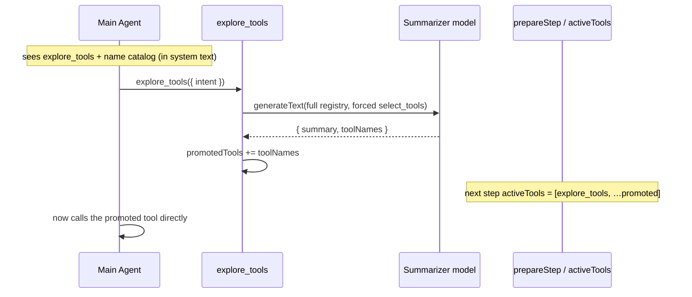

# Progressive tool disclosure (tool exploration)

> **Status: shelved — not implemented by the server-held loop.** Exploration was built into the
> in-browser loop, which no longer exists. `runModelLoop` has no `explore_tools` and offers every tool
> on every step (the set is live — refreshed between steps as the page reports changes, see
> [MCP tool integration §7](./mcp-tools.md#7-the-tool-set-is-live-within-a-turn) — but never gated).
>
> Its code was removed (the debug switch and flag, the browser helpers, the mock's `select_tools`
> seam and the tests); the version history holds it. What follows is the design to port, not
> current behaviour.

When many tools are registered (or they churn as the user navigates), sending every tool's full schema on every request bloats context and destabilises any prompt cache. An **opt-in** exploration mode replaces "send all tools" with "discover on demand": the assistant sees only a single always-on `explore_tools` tool plus a catalog of tool *names*, and must call `explore_tools` to make the tools it needs callable.

**How it worked:**

1. The full tool registry was still passed to `streamText`, but `activeTools` (returned from `prepareStep` each step) gated which tools were exposed to the model. It started as `[explore_tools]`.
2. `explore_tools.execute` ran the **summarizer** model over the full registry, forcing a `select_tools` tool call to get structured `{ summary, toolNames }`. Selected names were validated against the live registry and added to a `promotedTools` set.
3. `prepareStep` read `promotedTools` live, so a tool promoted at step *N* was callable at step *N+1* — within the same turn.
4. Promotions survived history compaction, pruned to the tools the retained window still referenced (`retainedToolNames`), and were cleared on reset. Tools that appeared mid-turn were announced as a `<tools-available>` message rather than made callable.

Gating limits which tools are *advertised*, not a hard execution barrier.

**For the port.** The server loop already has the hooks this needs: `runModelLoop` passes a `prepareStep` to `streamText`, so returning `activeTools` there is the natural place. The original folded the name catalog into the system text because the gateway hoisted all `system`-role messages into one block; with the gateway gone, placement (system vs. a tail message) should be decided against whatever prompt caching exists at that time.
